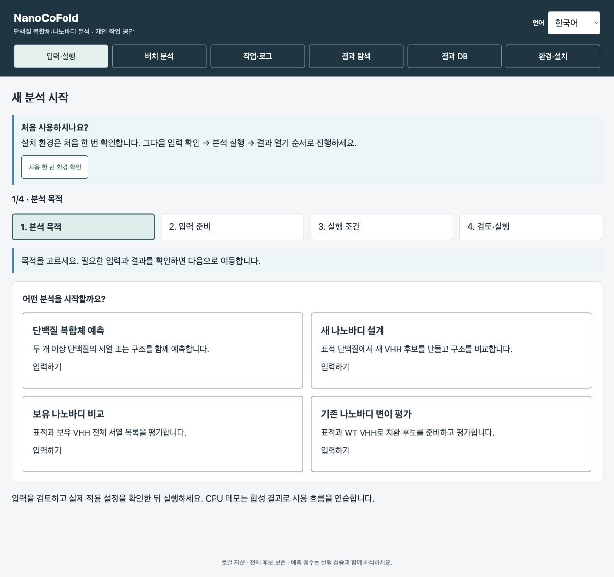
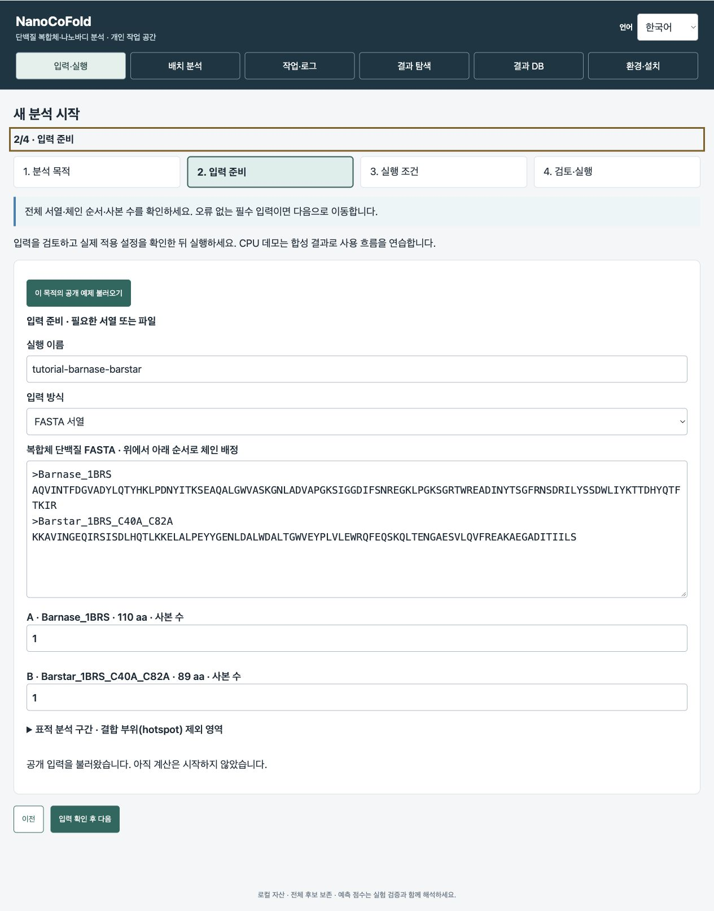
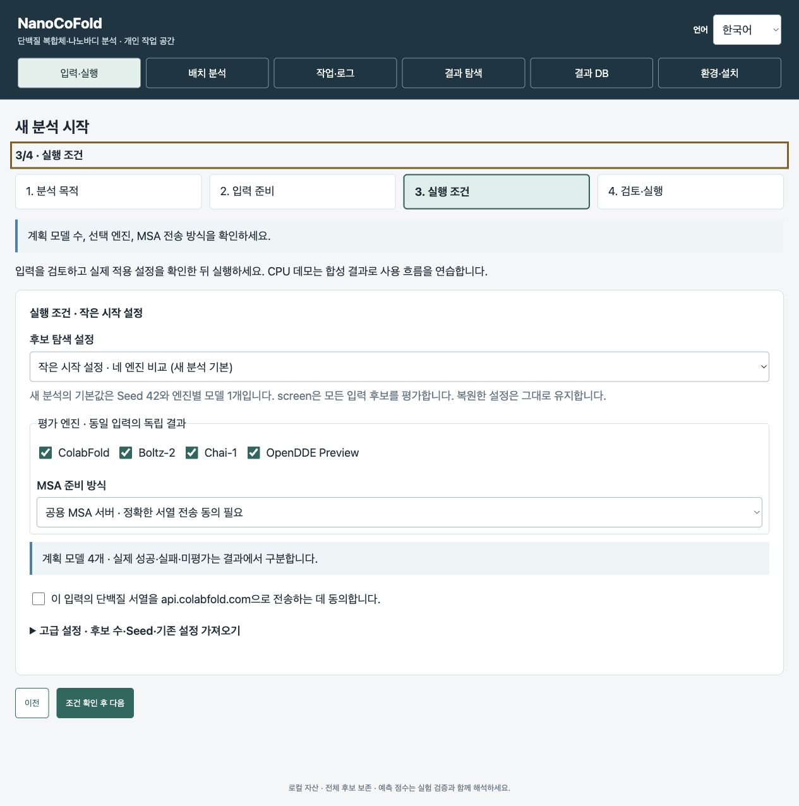
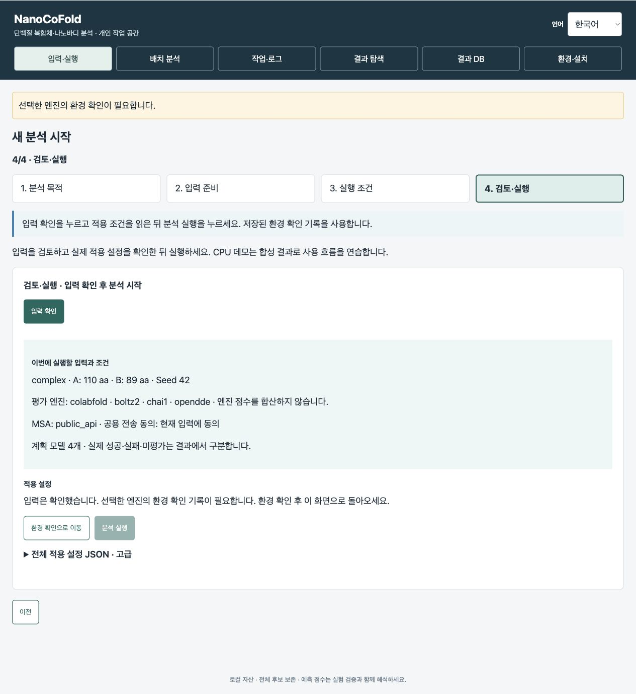
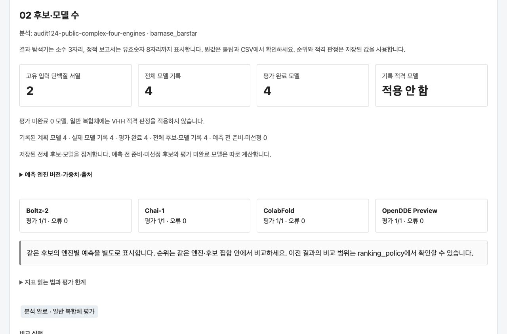

# NanoCoFold

[English](README.md) · **한국어**

**최신 설치본 [v0.4.8-install.11](https://github.com/kangk1204/NanoCoFold_public/releases/tag/v0.4.8-install.11)** · 계산 패키지 `0.4.8rc12`

단백질 복합체를 예측하고, 새 나노바디를 설계하거나 보유한 후보와 변이를 비교합니다. 결과는 3D로 살펴보고 대화형 보고서로 공유할 수 있습니다.

**처음 설치하는 컴퓨터**에서는 [1. 준비와 설치](#1-준비와-설치)부터 진행하세요. **이미 설치했다면** 처음 설치한 폴더에서 [기존 설치 업데이트](docs/UPDATE.ko.md)를 따라 하세요. **연구실 서버를 함께 쓰는 분**은 관리자가 알려준 계정으로 [내 자리에서 접속](docs/shared-lab.ko.md#사용자-pc)하세요.

**결과부터 보려면:** [예제 보고서 ZIP](https://github.com/kangk1204/NanoCoFold_public/releases/download/v0.4.8/NanoCoFold-EGFR-10-report.zip) 전체를 압축 해제한 뒤 **report.html**을 브라우저로 여세요. 설치나 GPU가 필요 없습니다. [새 실습 영상](https://kangk1204.github.io/NanoCoFold_public/quickstart/?lang=ko)에서 같은 방식으로 결과를 열고, 새 분석의 후보 서열과 3D 구조를 찾아 Excel로 저장하는 과정을 볼 수 있습니다.

**상세 설치와 입력 설명은 [EGFR 나노바디 변이 10종 실습 영상](https://kangk1204.github.io/NanoCoFold_public/watch/?v=first-run&lang=ko)을 보세요.** 영상은 27분, 17개 장입니다. Ubuntu에서 설치한 뒤 표적 서열과 결합 부위를 입력하고, 후보마다 CDR3 잔기 두 곳을 바꾼 변이 10종을 원래 나노바디(WT)와 비교합니다. 같은 작업을 결과 DB에서 찾아 전달 상태를 확인하고 보고서 ZIP을 여는 과정까지 담았습니다. [실습 입력 ZIP](https://github.com/kangk1204/NanoCoFold_public/releases/download/v0.4.8/NanoCoFold-EGFR-10-inputs.zip) · [영상 MP4](https://github.com/kangk1204/NanoCoFold_public/releases/download/v0.4.8/NanoCoFold-first-run-en.mp4) · [입력 준비 장부터 보기](https://kangk1204.github.io/NanoCoFold_public/watch/?v=first-run&lang=ko&chapter=inputs) · [영상의 결과 보고서 ZIP](https://github.com/kangk1204/NanoCoFold_public/releases/download/v0.4.8/NanoCoFold-EGFR-10-report.zip)

[플랫폼 소개 (28초)](https://kangk1204.github.io/NanoCoFold_public/watch/?v=intro&lang=ko) · [Ubuntu 설치 개요 (2분 30초)](https://kangk1204.github.io/NanoCoFold_public/watch/?v=install&lang=ko) · [네 모드 소개 (5분 47초)](https://kangk1204.github.io/NanoCoFold_public/watch/?v=walkthrough&lang=ko)

네 가지 분석 모드를 간단히 둘러보려면 **네 모드 소개**를 보세요. 영상은 영어 음성이며 한국어와 영어 자막을 선택할 수 있습니다. [설치 명령어와 영상 목차](docs/walkthrough.ko.md)

**내려받기** · [소개 MP4](https://github.com/kangk1204/NanoCoFold_public/releases/download/v0.4.8/NanoCoFold-intro-en.mp4) · [설치 MP4](https://github.com/kangk1204/NanoCoFold_public/releases/download/v0.4.8/NanoCoFold-install-en.mp4) · [전체 실습 MP4](https://github.com/kangk1204/NanoCoFold_public/releases/download/v0.4.8/NanoCoFold-walkthrough-en.mp4) · [자막 및 설치 안내](https://github.com/kangk1204/NanoCoFold_public/releases/tag/v0.4.8)

| 사용하는 컴퓨터 | 사용하는 방법 |
|---|---|
| NVIDIA GPU가 있는 Ubuntu x86_64 | 아래 요구 사항을 확인한 뒤 이 컴퓨터에 설치하고 계산합니다. |
| Windows·macOS | 설치된 서버에 브라우저로 접속하거나, 받은 보고서 ZIP을 열어 결과를 확인합니다. |
| Windows의 WSL | 설치 전 서버 관리자에게 WSL·GPU·드라이버 호환성을 확인하세요. |

| 지금 하려는 일 | 시작할 위치 |
|---|---|
| 새 Ubuntu GPU 컴퓨터에 처음 설치 | [1. 준비와 설치](#1-준비와-설치) |
| 이미 설치된 컴퓨터·서버에서 분석 | [2. 브라우저 열기](#2-브라우저-열기) → [3. 공개 예제](#3-첫-공개-예제-따라-하기) |
| 기존 나노바디에서 변이 100종 평가 | [CDR3 구간, 치환 수, WT 대조군 설정](#예시-cdr3-변이-100종-평가) |
| 다른 사람이 보낸 결과만 보기 | **결과 ZIP 전체**를 풀고 **START_HERE.html**이 있으면 그 파일을, 없으면 **report.html**을 여세요. 설치나 GPU는 필요 없습니다. |

**환경 확인 → 입력 준비 → 조건 확인 → 분석 한 번 실행 → 결과 열기** 순서입니다.

**환경 확인을 마치면 분석 준비하기를 누르세요.** `diagnostics · 완료`는 환경 확인 기록입니다. 분석은 [3번](#3-첫-공개-예제-따라-하기)에서 시작합니다.

필수 항목에 **필수 확인**이 표시되면 **다음 단계**의 안내를 처리한 뒤 분석하세요. **기술 진단 원문**은 서버 관리자에게 전달할 상세 기록입니다.

[공동연구자 안내: 작동 원리·설치·결과 확인](docs/collaborator-guide.ko.md)

[한글 그림으로 단계별 따라 하기](docs/browser_quickstart.md#그림으로-따라-하기) · [결과 찾기와 전달](#5-결과-읽기와-전달)

## 1. 준비와 설치

첫 네 엔진 예제의 설치 조건입니다.

| 항목 | 조건 |
|---|---|
| 운영체제 | Ubuntu x86_64, glibc 2.34 이상 |
| GPU | NVIDIA GPU, 드라이버 580 이상 |
| GPU 메모리 | 16 GB 이상 |
| 시스템 메모리 | RAM 32 GB 이상 |
| 저장공간 | SSD 여유 공간 150 GiB 이상 |
| 기타 | 인터넷 연결, `sudo` 권한 |

`nvidia-smi`로 GPU와 메모리를 확인하세요. 긴 단백질이나 많은 후보를 분석할 때는 추가 자원이 필요합니다.

GPU 메모리가 16 GB 미만이면 서버 관리자와 사용할 엔진·입력 크기를 정한 뒤, 해당 구성으로 환경 확인을 진행하세요.

설치기가 Python 환경, 엔진, 모델을 자동으로 준비합니다. NVIDIA 드라이버는 서버 관리자가 미리 설치합니다.

1. [v0.4.8 소스 ZIP (설치 수정판 11)](https://github.com/kangk1204/NanoCoFold_public/archive/refs/tags/v0.4.8-install.11.zip)을 내려받아 전체를 압축 해제합니다. Git으로 clone했다면 그 저장소 폴더를 사용합니다.
2. 릴리스 ZIP은 **`NanoCoFold_public-0.4.8-install.11` 폴더**, Git clone은 **`NanoCoFold_public` 폴더**를 엽니다.
3. 이 폴더 안에서 터미널을 엽니다. `README.md`, `install.sh`, `start.sh`가 보이면 맞습니다.
4. 첫 복합체 예제의 네 엔진을 준비하려면 아래 **세 명령을 순서대로, 같은 폴더에서** 실행합니다. 한 명령이 `[설치 완료]`로 끝난 뒤 다음 명령을 실행하세요.

GPU가 여러 개이면 명령을 실행하기 전에 아래 **여러 GPU** 안내를 먼저 펼치세요.

```bash
bash install.sh --profile complex
bash install.sh --profile colabfold
bash install.sh --profile opendde
```

<details>
<summary>여러 GPU·다른 분석 목적·설치 중 오류가 있을 때</summary>

`complex`는 Boltz-2·Chai-1, 나머지 두 명령은 ColabFold·OpenDDE를 준비합니다. GPU가 한 개이면 자동으로 선택합니다. 여러 개라면 `nvidia-smi -L`에서 사용할 GPU UUID 전체를 확인해 **세 명령 모두 같은 UUID**를 넣습니다.

```bash
bash install.sh --profile complex --gpu GPU-xxxxxxxx-xxxx-xxxx-xxxx-xxxxxxxxxxxx
bash install.sh --profile colabfold --gpu GPU-xxxxxxxx-xxxx-xxxx-xxxx-xxxxxxxxxxxx
bash install.sh --profile opendde --gpu GPU-xxxxxxxx-xxxx-xxxx-xxxx-xxxxxxxxxxxx
```

첫 설치에서는 엔진과 모델 파일을 내려받습니다. `[설치 완료]`가 표시될 때까지 기다리세요. 중단되면 같은 폴더에서 같은 명령을 다시 실행합니다. 기존 다운로드와 설치 기록은 이어서 사용합니다.

설치 오류와 재시도 방법은 터미널 안내와 [설치 문제 해결](docs/installation.md)에서 확인하세요.

새 나노바디 설계·보유 후보 비교·변이 평가까지 사용하려면 아래 명령으로 전체 환경을 설치하세요. 옵션 없는 `bash install.sh`도 `all` 설치를 실행합니다.

```bash
bash install.sh --profile all
```

여러 GPU가 있는 컴퓨터에서는 이 선택 설치에도 위와 같은 `--gpu` UUID를 추가합니다. 설치·소프트웨어 검사·실제 예측의 확인 범위는 [검증 기록](docs/VALIDATION.md)에서 구분해 확인할 수 있습니다.

`Driver/library version mismatch`가 표시되면 서버 관리자에게 드라이버 점검을 요청하세요. `nvidia-smi`가 정상 작동하면 설치를 다시 진행합니다. [설치 문제 해결](docs/installation.md)

</details>

## 2. 브라우저 열기

**NanoCoFold를 설치한 Ubuntu 컴퓨터**의 **같은 소스 폴더**에서 실행합니다. 원격 서버라면 아래 두 터미널 안내를 따르세요.

```bash
bash start.sh --port 18765
```

터미널의 **`NanoCoFold:` 뒤에 표시된 주소**를 브라우저에서 여세요. 위 명령의 기본 주소는 [http://127.0.0.1:18765](http://127.0.0.1:18765)입니다. 화면 상단에 **NanoCoFold**가 표시되는지 확인하고, 사용하는 동안 서버 터미널을 열어 두세요. `127.0.0.1`은 현재 PC를 가리킵니다. 원격 서버 접속은 아래 안내를 따르세요.

**서버 실행 중 화면:** 터미널에 `NanoCoFold:` 주소가 표시되고, 새 명령 프롬프트 없이 열린 상태로 유지됩니다. 브라우저에서 이 주소를 열어 사용하세요. 사용하는 동안 터미널을 열어 둡니다.

**다른 프로그램이 같은 포트를 사용 중이면** 아래 명령으로 빈 포트를 선택하고, 새로 출력된 주소를 여세요.

```bash
bash start.sh --port 0
```

원격 서버에서 `--port 0`을 사용하면 터미널에 출력된 서버 포트로 SSH 연결을 설정합니다.

화면이 준비되면 분석 목적을 선택하세요. 로딩 오류가 나면 **화면 다시 불러오기**를 누릅니다. 처음에는 영어로 열리며, 상단 **Language → 한국어**에서 언어를 바꿀 수 있습니다. 선택한 언어는 브라우저에 저장됩니다.

<details>
<summary>내 PC에서 원격 Ubuntu 서버에 접속할 때</summary>

**터미널 1 · 설치한 Ubuntu 서버에서:**

```bash
bash start.sh --no-browser --port 18765
```

**터미널 2 · 내 PC에서:** `USER@SERVER`를 서버 계정과 주소로 바꿉니다.

```bash
ssh -o ExitOnForwardFailure=yes -L 18765:127.0.0.1:18765 USER@SERVER
```

두 터미널을 열어 둔 상태에서 내 PC 브라우저로 전달한 주소에 접속하세요. 입력과 결과 확인은 PC에서, 계산은 Ubuntu 서버에서 진행됩니다. 서버 포트가 다르면 SSH 명령의 오른쪽 포트를 바꿉니다.

공개 설치기의 기본 작업 공간은 소스 폴더 아래 `.nanocofold/workspace`입니다. `--workspace`로 다른 위치를 지정할 수 있으며, `start.sh`는 저장된 위치를 사용합니다.

PC의 18765 포트가 사용 중이면 다음과 같이 18766으로 연결하고 **http://127.0.0.1:18766**을 여세요. 서버 포트가 다르면 명령의 마지막 `18765`를 바꿉니다.

```bash
ssh -o ExitOnForwardFailure=yes -L 18766:127.0.0.1:18765 USER@SERVER
```

</details>

<details>
<summary>기존 설치를 업데이트할 때 · 작업 완료 후</summary>

### 기존 설치에서 화면 업데이트

대기·실행 중인 작업이 없을 때 서버 터미널에서 **Ctrl+C**로 웹 서버를 닫습니다. **ZIP으로 설치했다면** [ZIP 업데이트 안내](docs/UPDATE.ko.md#2-새-소스-받기)를 따르세요. **Git의 `main` 브랜치로 설치했다면** 처음 설치한 소스 폴더에서 다음 명령을 실행하세요.

```bash
git pull --ff-only
bash update.sh
bash start.sh --port 18765
```

업데이트 후 브라우저를 새로고침하세요. 작업 공간, 모델, 입력, 결과는 유지됩니다. 예전 보고서에 새 화면을 적용하려면 새 사본으로 내보내세요.

업데이트가 중단되면 `bash update.sh`를 다시 실행하세요. 진행 중인 작업과 웹 서버를 모두 종료한 상태에서 업데이트합니다.

</details>

<details>
<summary>설치본 버전 확인</summary>

`bash start.sh`는 저장된 작업 공간의 설치본을 실행합니다. 소스 폴더에서 다음 명령으로 설치본 버전을 확인하세요.

```bash
.nanocofold/workspace/.venv-dev/bin/nanocofold --version
```

별도 작업 공간은 `.nanocofold/install-location.json`의 `workspace` 경로를 사용하세요. 이전 버전을 업데이트하려면 모든 작업을 마치고 웹 서버를 닫은 뒤, 위 **기존 설치를 업데이트할 때** 절차를 따릅니다.

**소스 개발 시** 체크아웃 버전과 모듈 경로는 다음 명령으로 확인합니다.

```bash
source .nanocofold/workspace/.venv-dev/bin/activate
python -m nanocofold --version
python -c "import nanocofold; print(nanocofold.__file__)"
```

별도 작업 공간은 활성화 명령에도 저장된 경로를 사용하세요. 개발용 `python -m nanocofold serve --workspace . --port 18765`는 현재 소스와 지정한 작업 공간을 사용합니다. 결과 등록 시 링크 경로가 거부되면 `pwd -P`로 작업 공간의 실제 경로를 확인해 지정하세요.

</details>

## 3. 첫 공개 예제 따라 하기

**단백질 복합체 예측** 공개 예제를 사용합니다. 표의 순서대로 진행하세요.

| 순서 | 누를 버튼·확인할 값 | 이 상태이면 다음으로 |
|---|---|---|
| A · 환경, 처음 한 번 | **처음 한 번 환경 확인** → **단백질 복합체 예측** 선택 → **환경 확인 시작** | 같은 화면에 **환경 확인 완료**가 표시되면 **분석 준비하기**를 누릅니다. |
| B · 예제 | **이 목적의 공개 예제 불러오기** | Barnase **110 aa**, Barstar **89 aa**, 사본 **각 1개**가 채워집니다. |
| C · 입력 | 두 서열·체인 순서·사본 수 확인 → **입력 확인 후 다음** | **실행 조건** 화면이 열립니다. |
| D · 조건 | **작은 시작 설정**, **엔진 4개**, **계획 4모델** 확인. 공용 MSA 사용 시 현재 공개 서열을 **api.colabfold.com**에 보내는 동의 체크 → **조건 확인 후 다음** | **검토·실행** 화면이 열립니다. |
| E · 검토 | **입력 확인** → 입력·조건 요약 확인 | **분석 실행** 버튼이 켜집니다. |
| F · 계산 | **분석 실행**을 한 번 누름 → **작업·로그** | 제출한 분석 작업을 선택하고 완료를 기다립니다. |
| G · 결과 | 완료된 분석의 **결과 열기** | 후보·모델 표가 나타납니다. 행을 누르면 점수·3D 구조·PAE를 봅니다. |

**분석이 진행 중인지 확인하기:** **작업·로그**에서 방금 제출한 작업을 선택하세요. **실행 중** 상태, 현재 단계, 모델 수, 경과 시간이 자동으로 갱신됩니다. 모델 하나를 계산하는 동안 단계와 모델 수가 한동안 같을 수 있습니다. 자세한 내용은 **상세 실행 로그**를 펼쳐 확인하세요. **완료**되면 **결과 열기**를 누릅니다. 브라우저에서 뒤로 갔다면 **작업·로그**로 돌아와 같은 작업을 다시 여세요. 분석은 계속됩니다. [작업 확인·중단·재개](#6-작업-확인중단재개)

**분석 준비하기**를 누르면 선택한 목적의 **입력 준비** 화면이 열립니다. 여기서 공개 예제를 불러오세요. 목적 선택 화면에서 시작하는 경우에는 **단백질 복합체 예측 · 입력하기**를 누릅니다.

환경 확인이 필요하다는 안내가 나오면 **환경 확인으로 이동 → 환경 확인 완료 → 분석 준비하기** 순서로 진행하세요. 설치·GPU·선택 엔진이 같으면 저장된 환경 확인 기록을 재사용합니다.

예제 설정은 Seed **42**, **엔진당 1모델**, 총 **4모델**입니다. 실행 후 결과에서 완료·실패·미평가 수를 확인하세요. 서열을 바꾸면 입력 검토와 MSA 전송 동의를 다시 확인합니다.

<details>
<summary>각 단계 핵심 설정과 한글 스크린샷 보기</summary>

단계별 설정과 한글 화면입니다. 모든 그림은 **0.4.8rc9**(`26925c3`) 화면을 **2026년 10월 18일**에 촬영했습니다. 결과에서 완료·실패·미평가 모델 수를 확인하세요. [촬영 기록](docs/images/quickstart-rc9/README.md)

| 단계 | 확인할 핵심 설정 | 저장된 화면 예시 |
|---|---|---|
| 환경 확인 · 처음 한 번 | 분석 목적 → 환경 확인 시작 → 분석 준비하기 | [그림 0](docs/images/quickstart-rc9/ko/environment.jpg) |
| 목적 선택 | 단백질 복합체 예측 | [그림 1](docs/images/quickstart-rc9/ko/01-purpose.jpg) |
| 입력 준비 | Barnase 110 aa + Barstar 89 aa, 사본 각 1개 | [그림 2](docs/images/quickstart-rc9/ko/02-input.jpg) |
| 실행 조건 | 작은 시작 설정, 네 엔진, Seed 42, 엔진당 1모델 → 계획 4모델 | [그림 3](docs/images/quickstart-rc9/ko/03-settings.jpg) |
| 검토·실행 | 현재 서열 전송 동의 → 입력 확인 → 환경 기록 재사용 → 분석 실행 한 번 | [그림 4 · 환경 확인이 필요한 경우](docs/images/quickstart-rc9/ko/04-review.jpg) |
| 결과 확인 | 평가 완료·실패·미평가 수 → 후보 선택 → 구조·PAE | [그림 5](docs/images/quickstart-rc9/ko/05-results.jpg) · [구조](docs/images/quickstart-rc9/ko/06-structure-pae.jpg) · [PAE](docs/images/quickstart-rc9/ko/07-pae.jpg) |

<details>
<summary>그림 1–2 · 목적을 고르고 공개 입력 확인하기</summary>





</details>

<details>
<summary>그림 3–4 · 핵심 설정과 계산 전 검토 위치 보기</summary>

첫 실행에서는 기본 설정을 사용하세요. 그림 3에서 공개 예제의 서열 전송에 동의한 뒤 다음으로 이동합니다. 그림 4는 환경 확인이 필요한 상태이며, 환경 확인을 마치면 분석을 실행할 수 있습니다.





</details>

<details>
<summary>그림 5 · 실제 GPU 결과에서 무엇을 확인하는지 보기</summary>

rc5에서 계산한 Barnase–Barstar GPU 결과를 rc9 오프라인 보고서 화면으로 연 예시입니다. 평가된 모델 4개와 각 엔진의 점수를 확인할 수 있습니다. 화면을 다시 촬영하면서 예측을 재실행하거나 저장된 데이터를 바꾸지 않았습니다.



</details>

</details>

[단계별 버튼과 결과 읽기](docs/browser_quickstart.md) · [예제 서열 출처와 기존 JSON](examples/tutorial/README.md) · [분석 과정과 선별 논리](docs/ANALYSIS_WORKFLOW.md)

**새 나노바디 설계**의 작은 시작 설정은 RFantibody와 BoltzGen에 백본을 하나씩 요청합니다. 생성된 후보를 네 엔진에서 평가하면 **최대 8개 대표 모델**을 비교합니다. 규모를 바꾸기 전에 **실행 조건 → 분석 규모**의 **적용값·출처**를 확인하세요.

| 설정 | 뜻 |
|---|---|
| 백본 수 | 각 생성기에 요청할 골격 구조 수. 백본 하나에서 여러 서열을 제안할 수 있습니다. |
| 후속 평가 상한 | 표시된 평가 단계에 전달할 후보 수. 모델 총수는 선택한 엔진 수에도 따라 달라집니다. |
| Seed | 난수 초기값. 후보 수와 별개입니다. |
| 최종 선별 상한 | 여러 엔진 비교에서는 엔진별로 적용하는 선별 기록 수의 상한 |

고유 서열 수와 모델의 성공·실패·미평가 수는 결과에서 확인합니다. 숫자칸을 비우면 화면에 표시된 프리셋·가져온 설정값을 유지합니다. 큰 작업은 **분석 실행** 뒤 규모 확인창이 열립니다. 취소하면 작업을 제출하지 않고 입력을 유지합니다.

핫스팟 추천 제외에는 자동 추천에서 뺄 태그·융합 구간을 입력합니다. 해당 구간의 구조와 접촉 평가는 유지되며 결합을 금지하지 않습니다. 구조 입력은 결합 부위 위치에서 원하는 잔기를 지정합니다. 서열만 입력하면 예측 구조에서 자동 추천합니다. 별도 제외가 없으면 빈칸으로 둡니다. 분석 시작·끝을 지정하면 실제 분석에 쓰는 표적 구간이 바뀝니다.

## 4. 자신의 입력 사용하기

| 화면의 목적 | 필요한 입력 | 확인할 결과 |
|---|---|---|
| 단백질 복합체 예측 (`complex`) | 함께 예측할 단백질들의 전체 서열 | 체인 쌍 점수·복합체 구조·PAE |
| 새 나노바디 설계 (`design`) | 표적의 전체 서열 또는 구조 | 새 VHH 서열·엔진별 구조·후보 표 |
| 보유 나노바디 비교 (`screen`) | 표적 + 후보별 전체 VHH 서열 | 후보별·엔진별 예측과 점수 |
| 기존 나노바디 변이 평가 (`mature`) | 표적 + 원본 전체 VHH 서열 | WT·CDR 변이·같은 엔진 WT 대비 비교 |

[새 설계·보유 후보 비교·변이 평가의 핵심 설정 화면](docs/browser_quickstart.md#목적별-설정-스냅샷)도 같은 안내에 있습니다.

입력은 **아미노산 FASTA**를 사용합니다. `>이름` 다음 줄에 서열을 적으며, 나노바디는 **전체 VHH 서열**을 넣습니다. 각 이름은 서로 다르게 정하고 `=`, `+`, `-`, `@`로 시작하지 않게 하세요. 준비한 치환·삽입 변이는 `screen`에서 비교할 수 있습니다.

구조는 **파일 업로드**와 **PDB ID** 중 하나로 입력합니다. **입력 방식 바꾸기**로 전환할 수 있습니다. VHH·WT 서열은 FASTA를 붙여 넣거나 파일로 불러오세요. **다른 파일 불러오기**로 교체하고 **이전 FASTA 복원**으로 되돌립니다. 초안을 불러온 경우 구조 파일을 다시 선택하고 입력·전송 동의를 확인하세요.

구조 파일을 사용하면 체인·잔기 번호·누락 잔기를 확인하세요. 공용 MSA는 서열을 외부 서버로 전송합니다. 연구 서열에는 기관 정책에 맞는 MSA 방식을 선택하세요.

### 예시: CDR3 변이 100종 평가

1. **기존 나노바디 변이 평가**를 선택하고 표적과 원본 나노바디(WT)의 전체 서열을 입력한 뒤 **입력 확인 후 다음**을 누릅니다.
2. **실행 조건 → 변이 생성 설정**에서 **CDR 무작위 다중 잔기 치환 → CDR3만**을 선택합니다. CDR의 일부만 바꾸려면 **지정 CDR 구간**을 선택하세요. 잔기 번호는 입력한 WT 나노바디의 첫 잔기부터 1로 셉니다.
3. **생성할 변이 후보 수 · WT 제외**에 **100**을 입력합니다. 후보마다 정확히 네 잔기를 바꾸려면 **후보당 최소 치환 잔기 수**와 **후보당 최대 치환 잔기 수**를 모두 **4**로, 두 잔기라면 모두 **2**로 설정합니다. **WT 대조군 평가**는 **포함**을 선택합니다.
4. 네 엔진 시작 설정과 seed 하나를 사용하면 **(변이 100종 + WT 1종) × 엔진 4개 = 계획 모델 404개**입니다. 가능한 변이가 100종보다 적으면 후보 수를 줄이거나 CDR 안에서 범위를 넓히세요.
5. 입력 서열에 맞는 MSA 준비 방식을 고릅니다. 공용 MSA를 쓰면 서열 전송에 동의해야 합니다. **조건 확인 후 다음 → 입력 확인 → 분석 실행**을 누르고 **작업·로그**에서 진행 상황을 확인하세요.

결과의 **검토 보류**는 자동 선별 전에 확인할 서열 특성이 있다는 뜻입니다. 구조 기준을 통과한 모델도 보류될 수 있습니다. 이전에 만든 **같은 변이**를 다시 비교하려면 **보유 나노바디 비교**에 저장한 VHH 서열을 한 종씩 중복 없이 넣으세요.

<details>
<summary>선택: GPU 없이 터미널에서 작은 변이 평가 연습하기</summary>

소스 폴더에서 `source .nanocofold/workspace/.venv-dev/bin/activate`로 환경을 활성화하고 아래 명령을 실행하세요. 공개 FASTA로 **최대 3개 DMS 변이**를 만들고 **변이 후보 최대 2개**를 평가합니다. `--mock`은 연습용 구조와 CDR 주석을 생성합니다.

별도 `--workspace`로 설치했다면 활성화 명령의 `.nanocofold/workspace`를 해당 작업 공간 경로로 바꾸세요. 저장된 경로는 `.nanocofold/install-location.json`에 있습니다.

```bash
nanocofold run --mode mature --mock \
  --wt-fasta examples/tutorial/wt_vhh.fasta \
  --set target.fasta=examples/tutorial/target.fasta \
  --set mature.cdr.source=config \
  --set mature.library.max_variants=3 \
  --set mature.prefilter.top_n=2 \
  --set run.name=mature_mock_small
```

터미널에 **10초마다** 경과 시간과 현재 단계가 표시됩니다. 예측 전에 실제 평가 후보 수가 표시되고, 점수 계산 중에는 **후보 n/전체 수**가 나옵니다. 끝나면 터미널에 출력된 **report.html** 경로를 여세요. 보고서를 옮길 때는 연결된 파일도 함께 보관합니다.

짧은 연습에는 위의 `max_variants=3`, `top_n=2`를 사용하세요. 성숙화 연구 기본값은 변이 후보를 최대 **200개** 평가합니다. 실제 분석은 `--mock`을 빼고 연구 서열과 확인된 CDR 주석으로 실행합니다.

</details>

## 5. 결과 읽기와 전달

**결과를 여는 경로:** **작업·로그 → 자신이 제출한 분석 작업 선택 → 결과 열기**. 작은 화면에서는 작업 상세 아래로 내려 버튼을 찾으세요. 같은 작업 공간의 저장 결과는 **결과 탐색 → 실행 선택**에서도 다시 열 수 있습니다.

| 지금 보이는 것 | 다음에 할 일 |
|---|---|
| **diagnostics / 환경 확인 · 완료** | **분석 준비하기**를 누르고 [3번](#3-첫-공개-예제-따라-하기)을 진행합니다. |
| 분석 **완료**, **결과 열기** 버튼 있음 | 결과를 열고 성공·실패·미평가 수를 확인한 뒤 모델을 선택합니다. |
| 실패·취소·중단·시간 소진 | **상세 실행 로그**에서 원인을 확인하고 [6번](#6-작업-확인중단재개)에 따라 이어서 진행합니다. |
| **결과 열기**가 없거나 저장 실행이 안 보임 | 사용한 작업 공간에서 분석 작업을 선택하고 상태·로그를 확인합니다. |

**상태·모델 수 → 후보·모델 행 선택 → 점수·구조·PAE → 다운로드** 순서로 봅니다. X·Y 선택기로 현재 표시할 비교 지표를 고릅니다. [차트 예시](docs/images/quickstart-rc9/ko/charts.jpg) · [보고서 목차](docs/images/quickstart-rc9/ko/report-nav.jpg).

- **전체 구조 보기/맞춤**: 복합체 전체를 봅니다. **표적 선택/나노바디 선택** 또는 **기준 체인 선택/파트너 선택**: 해당 체인을 강조하고 확대합니다. **선택 해제**: 강조를 지웁니다.
- PAE 히트맵의 셀을 누르면 두 잔기를 선택·확대하고 구조 뷰어로 이동합니다. PAE는 예측한 잔기 사이 상대 위치의 불확실성을 나타냅니다.
- CSV/XLSX 표, FASTA, 좌표와 **보고서 ZIP**을 저장합니다. Excel에서는 UTF-8 BOM이 포함된 내보내기 CSV 또는 XLSX를 사용하세요. 실행 폴더의 CSV는 기계 처리용 UTF-8 기록입니다. **선택한 표시 좌표 저장**은 표시 좌표를 저장합니다. **원본 엔진 좌표 다운로드**는 기록된 해시와 일치하는 원본이 보존됐을 때 사용할 수 있습니다. 출처 안내에서 원본과 표시 좌표의 관계를 확인하세요.

**전체 원본 ZIP · 로컬 보관용**은 서버 경로와 실행 로그를 포함하므로 개인 복구·보관에 사용합니다. 공동연구자에게는 **전달용 보고서 ZIP** 전체를 전달하세요. 받는 사람은 ZIP 전체를 풀고 `report.html`을 엽니다. macOS·Windows·일반 PC에서도 GPU나 프로그램 설치 없이 저장된 결과를 읽을 수 있습니다.

**전달용 ZIP에는 실패·미평가 기록을 포함한 모든 저장 후보·서열과 보존된 구조·PAE가 들어갑니다. 화면 필터로 전달 범위가 줄어들지 않습니다.** 분석 전체를 수신자와 공유해도 되는지 확인하세요. MSA·로그·가중치·중간 계산 파일은 빠지므로 재실행용 전체 원본은 별도로 보관합니다. 오프라인 3D 보기는 최신 Chrome·Edge·Firefox의 WebGL이 필요합니다.

### 보고서는 여섯 구간 순서로 읽으세요

| 구간 | 확인할 내용 |
|---|---|
| 01 입력·설정 | 의도한 서열과 조건으로 실행했는지 확인합니다. |
| 02 후보·모델 수 | 완료·실패·미평가 모델 수를 확인합니다. 일반 복합체에서는 체인 쌍 점수를 봅니다. |
| 03 후보 비교 | 후보·모델과 예측 엔진을 선택하고 기록된 점수를 읽습니다. |
| 04 제외·미평가 | 선별 결과가 0건이면 기준에서 제외된 후보와 미평가 후보의 사유를 확인합니다. |
| 05 구조·PAE | 선택한 모델의 구조와 잔기 상대 배치의 불확실성을 함께 봅니다. |
| 06 출처·산출물 | 기록된 조건을 확인하고 필요한 보고서·데이터를 저장합니다. |

**후보 서열과 구조 확인하기**

**결과 탐색 → 이 실행의 우선 검토 후보**에서 **서열과 예측 구조 보기**를 누르면 해당 엔진의 최종 선별 1위를 확인할 수 있습니다. 서열을 복사하거나 FASTA로 저장하세요. 적격 후보가 없으면 04에서 이유를, 다른 후보는 03에서 확인하세요. 전달 ZIP의 `sequences.fasta`에는 전체 서열이, 원본의 `05_final/selected_candidates.csv`에는 최종 선별 목록이 있습니다.

**내 분석에서 후보 찾기.** **결과 DB → 후보 서열·구조**에서 표적 이름과 예측 엔진을 고르고, **기록 판정 → 적격 → 검색**을 누르세요. **최종 선별 순위**를 누르면 각 분석·엔진의 선별 1위부터 볼 수 있습니다. 후보 ID를 누르면 해당 서열, 3D 구조와 지표가 열립니다. **검색 결과 전체 Excel 저장**은 다음 페이지까지 포함해 현재 조건과 정렬로 저장합니다. 분석 전체를 보려면 분석명을 누르세요.

새 결과는 자동 등록되며 이전 등록 결과도 서버가 순차적으로 색인합니다. 연구원은 기본적으로 본인 제출분을 봅니다. `admin`은 전체 연구원과 담당자 미기록 결과를 조회하고, 필요할 때 전체 열람을 허용하거나 회수할 수 있습니다. 로그인 후 계정 이름 옆 **비밀번호 변경**에서 내 비밀번호를 바꿀 수 있습니다. [연구실 관리자 등록과 접속](docs/shared-lab.ko.md)

구간 링크와 브라우저 **뒤로 / 앞으로**로 보고서 안을 이동합니다. 분석은 계속 진행됩니다. 언어를 비교할 때는 같은 후보를 선택하세요.

관리자가 제공한 운영 사이트에서는 **작업 목록**, **보고서·출처**, **오프라인 HTML**, **검증된 단계 재개**로 표시될 수 있습니다. 보고서는 **오프라인 HTML**로 받습니다. 재개 버튼이 잠겨 있으면 표시된 이유를 확인하고 관리자에게 문의하세요.

<details>
<summary>파일 위치·이전 보고서·PyMOL이 필요할 때</summary>

### 저장된 파일 위치

브라우저에 표시된 작업 공간을 기준으로 찾습니다. 분석별 폴더는 `<workspace>/runs/<job_id>/`이며, 작업 ID는 **작업·로그**에서 확인합니다. 보고서 발행이 성공하면 그 폴더의 `report.html`부터 엽니다. `report_explorer-<hash>.html`로 연결되는 보고서는 해당 파일도 옆에 둡니다. 이전 보고서는 `report_explorer.html`을 사용할 수 있습니다. 폴더나 ZIP 전체를 함께 보관하고 연결된 탐색기 파일을 바꾸거나 지우지 마세요.

상세 worker 로그는 `<workspace>/.nanocofold/jobs/<job_id>/worker.log`, 제출한 설정은 같은 폴더의 `config.yaml`에 있습니다. 분석 폴더에는 `run_config.yaml`, `run_state.json`과 엔진 산출물이 저장됩니다. 작업 화면에서 진행 상태와 모델 수를 확인하세요.

브라우저와 새 대화형 보고서는 **Language → English / 한국어**에서 언어를 바꿉니다. 이전 보고서는 생성 당시 화면을 유지합니다. 최신 한영 화면이 필요하면 현재 앱에서 보고서를 다시 내보내고, 기존 보고서도 함께 보관하세요.

PyMOL 자료가 함께 제공되면 **폴더 전체**를 풀고 PyMOL의 **File → Open**에서 `.pml`을 엽니다. 스크립트와 참조 좌표의 상대 폴더 구조를 유지하세요. 일반 보고서 ZIP과 PyMOL 전용 자료는 별개입니다. [PyMOL에서 보기](docs/RESULTS.md#pymol에서-보기)

</details>

후보는 엔진별 점수, ipTM·계면 pLDDT·계면 PAE, 구조를 함께 검토해 선정합니다. 변이 평가에서는 WT를 대조군으로 비교하세요. 선정한 후보의 결합·KD·발현은 실험으로 확인합니다. [지표와 결과 읽기](docs/RESULTS.md)


[점수 집합·비교조건과 통계 해석](docs/STATISTICAL_INTERPRETATION.ko.md)을 함께 확인하세요.

## 6. 작업 확인·중단·재개

| 상황 | 해야 할 일 |
|---|---|
| 탭 이동·뒤로가기·언어 전환·브라우저 닫기 | 분석은 계속됩니다. 같은 작업 공간에서 기존 작업을 확인하세요. 서버와 계산 컴퓨터는 켜 두세요. |
| 진행률이 멈춘 것 같거나 연결이 끊김 | **상세 실행 로그**와 연결을 확인합니다. 마지막 표시 상태일 수 있으므로 중복 제출하지 마세요. |
| 분석을 멈추고 싶음 | **작업 취소** → 확인창에서 대상 확인 → 취소 확정. **취소 중 → 취소**가 될 때까지 기다립니다. **계속 진행**이나 Esc는 취소 요청을 보내지 않습니다. |
| 실패·중단·취소 작업에 **검증 후 재개**가 있음 | 로그의 원인을 해결한 뒤 **같은 작업**의 버튼을 누릅니다. 저장 입력·설정과 이전 프로세스 소유권을 검증한 뒤 다시 실행합니다. |
| **시간 소진** | 안내에 따라 추가 시간을 분 단위로 넣고 **검증 후 재개**합니다. |
| 재개 버튼이 없거나 사용할 수 없음 | 표시된 사유와 로그를 읽고 관리자에게 문의하세요. 운영 사이트에서는 계산 에이전트 업데이트가 필요할 수 있습니다. |

취소 중에는 계산 프로세스와 하위 도구를 종료하고 자원을 정리합니다. 취소 완료 후에도 저장된 결과는 남습니다. 미완료 모델은 재개 시 다시 계산할 수 있습니다. 배치에서는 항목 하나 또는 미완료 작업 전체를 확인 후 취소합니다.

중단된 작업은 **검증 후 재개**로 이어서 실행합니다. 저장된 결과는 언제든 열어볼 수 있습니다. 부분 결과는 작업 상태·완료 모델 수와 함께 확인하세요.

[변경 기록](CHANGELOG.md) · [검증 기록](docs/VALIDATION.md) · [외부 엔진·모델 이용 조건](LICENSE_MANIFEST.md)

프로젝트 자체에는 별도 공개 라이선스를 부여하지 않습니다. 외부 라이브러리·엔진·모델에는 각자의 이용 조건이 적용됩니다. 연결된 기술 문서와 원본 실행 로그는 한국어일 수 있습니다.

[영·한 전환의 적용 범위](docs/LANGUAGE_SUPPORT.md)
