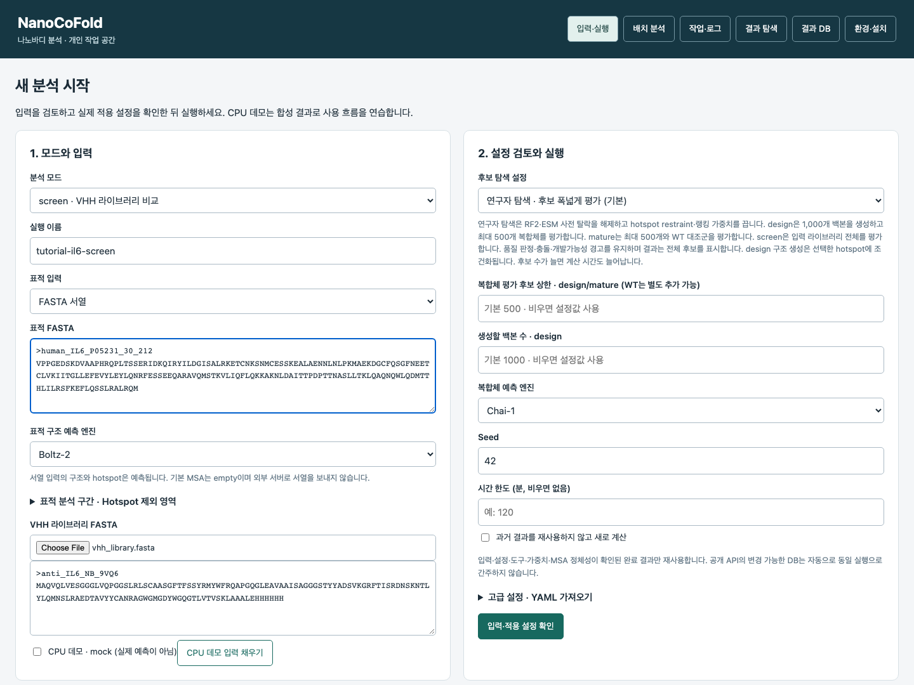
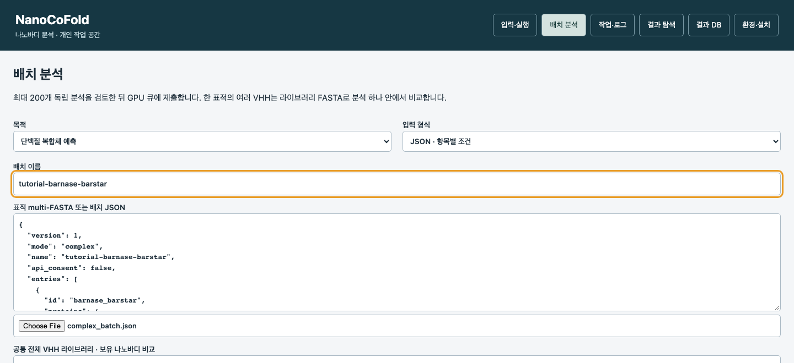
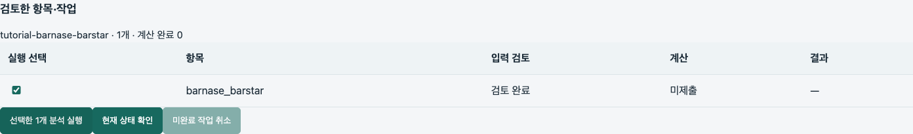
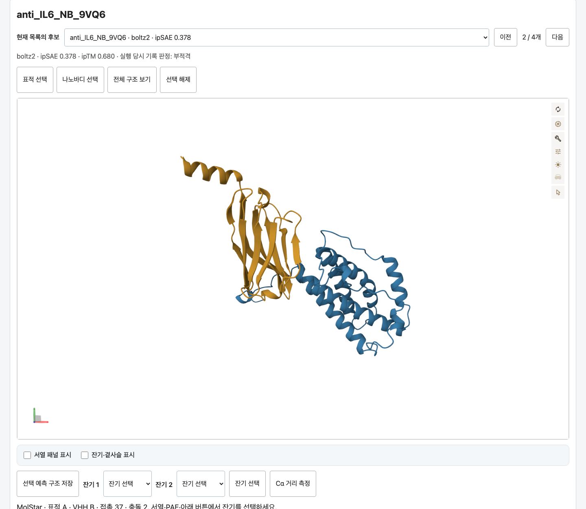
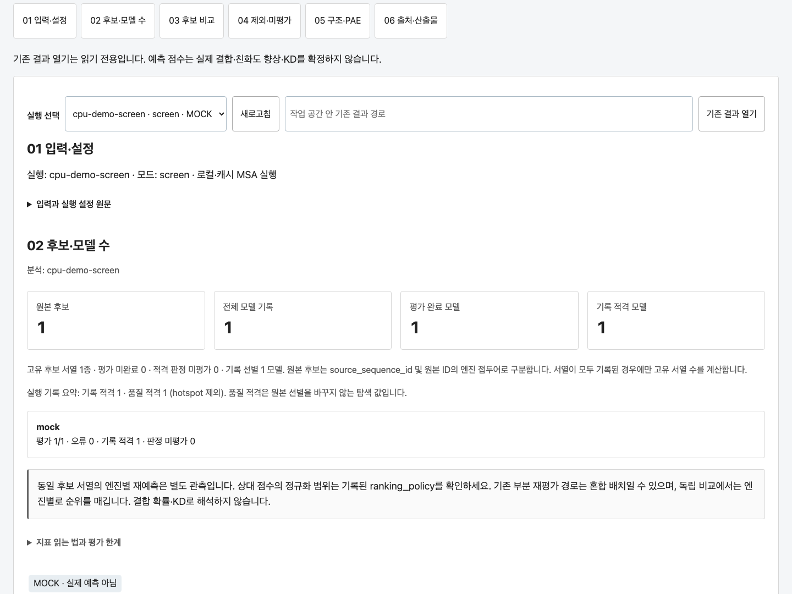

# NanoCoFold

단백질 서열에서 복합체 구조를 예측하고, 나노바디를 설계하거나 후보와 변이를 비교하는 프로그램입니다.
결과는 표, 3D 구조, PAE와 HTML 보고서로 확인합니다.

**현재 공개 버전: [v0.4.6](https://github.com/kangk1204/NanoCoFold_public/releases/tag/v0.4.6)** ·
[변경 기록](CHANGELOG.md) · [업데이트 방법](docs/UPGRADING.md)

## 1. 준비할 컴퓨터

- Ubuntu, Intel/AMD 64비트(x86_64), **glibc 2.34 이상**. Ubuntu 세부 버전 번호로 설치를 차단하지 않습니다.
- NVIDIA GPU와 정상 작동하는 `nvidia-smi`. 현재 고정 패키지는 **드라이버 580 이상**이 필요합니다.
- 작은 예제의 준비 기준: **GPU 메모리 16 GB 이상, RAM 32 GB 이상, 빈 SSD 150 GiB 이상**.
  긴 단백질이나 많은 후보에는 더 많은 메모리·시간이 필요합니다. 이 수치는 모든 입력의 성공 보장이 아닙니다.
- 인터넷과 `sudo` 권한. 설치 중 Ubuntu 로그인 비밀번호를 물을 수 있습니다.

Python, pip, NumPy, pandas, matplotlib, PyTorch, JAX를 미리 설치할 필요가 없습니다.
설치기가 기본 시스템 도구와 분리된 Python 환경, 엔진, 모델을 준비합니다.
CUDA Toolkit·Conda·Docker도 이 안내의 필수 준비물이 아닙니다. NVIDIA 드라이버는 변경하지 않습니다.

## 2. 내려받고 한 번에 설치

1. [소스 ZIP 받기](https://github.com/kangk1204/NanoCoFold_public/releases/download/v0.4.6/NanoCoFold_public-0.4.6.zip)를 누릅니다.
2. Ubuntu에서 ZIP을 압축 해제합니다.
3. 압축을 푼 **`NanoCoFold_public-0.4.6` 폴더 안에서** 터미널을 엽니다.
   그 폴더에 `README.md`, `install.sh`, `start.sh`가 보이면 맞습니다.
4. 아래 명령을 실행합니다.

```bash
bash install.sh
```

GPU가 한 개이면 자동으로 선택합니다. 여러 개이면 `nvidia-smi -L`에서 사용할 GPU의
전체 UUID를 확인하고 다음처럼 지정합니다. `GPU-...`는 실제 값으로 바꾸세요.

```bash
bash install.sh --gpu GPU-xxxxxxxx-xxxx-xxxx-xxxx-xxxxxxxxxxxx
```

기본 설치는 **네 모드와 네 예측 엔진에 필요한 환경 전체**를 준비합니다.
모델 파일이 커서 최초 설치는 네트워크에 따라 오래 걸릴 수 있습니다.
터미널의 단계·다운로드 로그를 확인하고 설치가 끝날 때까지 기다리세요.
설치만으로 분석이나 입력 서열 전송이 시작되지는 않습니다.

`[설치 완료]`가 나와야 다음 단계로 넘어갑니다. 오류가 나면 마지막 오류를 먼저 확인하세요.
다운로드 중단 후에는 **같은 명령**으로 다시 설치할 수 있습니다. 기존 모델·부분 다운로드·실패 기록은
보존하며, 전체 파일 해시와 준비 점검을 통과해야 완료로 표시합니다.
다른 설치나 분석이 실행 중일 때는 중복 실행하지 마세요.

`Failed to initialize NVML: Driver/library version mismatch`가 보이면 NVIDIA 드라이버와
라이브러리의 버전이 맞지 않는 상태입니다. Python 패키지를 다시 설치해도 해결되지 않습니다.
드라이버 업데이트 뒤 재부팅이 아직 필요한지 관리자와 확인하고, `nvidia-smi`가 정상적으로
GPU 표를 출력한 뒤 설치를 다시 실행하세요. `[설치 완료]` 전에는 `bash start.sh`를 실행하지 않습니다.

기본 작업 공간은 `.nanocofold/workspace`입니다. 별도 디스크에 설치하려면
`bash install.sh --workspace /절대/경로/workspace`를 사용합니다.
[설치 옵션·문제 해결](docs/installation.md)

## 3. 브라우저에서 열기

같은 폴더에서 실행합니다.

```bash
bash start.sh
```

[http://127.0.0.1:8765](http://127.0.0.1:8765)를 브라우저에서 엽니다.
이 터미널은 서버이므로 명령 입력줄이 돌아오지 않는 것이 정상입니다. 사용하는 동안 열어 두세요.

원격 Ubuntu 서버에 설치했다면 서버에서 `bash start.sh --no-browser`를 실행하고,
자신의 PC의 다른 터미널에서 아래처럼 연결합니다. `USER@SERVER`는 자신의 계정·주소입니다.

```bash
ssh -L 8765:127.0.0.1:8765 USER@SERVER
```

그다음 자신의 PC에서 같은 브라우저 주소를 엽니다. 인터넷에 서버 포트를 공개할 필요는 없습니다.

아래는 실제 프로그램에 공개 IL‑6·VHH 서열을 넣은 입력 화면입니다.
직접 입력할 수도 있고, 처음에는 **5절의 배치 JSON 업로드**로 예제의 서열과 조건을 함께 불러오는 것이 편합니다.



## 4. 네 모드 중 하나 선택

| 모드 | 하고 싶은 일 | 필요한 입력 | 얻는 결과 |
|---|---|---|---|
| `complex` | 정해진 단백질들이 이루는 복합체 예측 | 함께 예측할 단백질 서열 | 복합체 구조·체인 쌍 점수·PAE |
| `design` | 표적에 대한 새 나노바디 후보 생성 | 표적 서열 또는 구조 | 새 VHH 서열·엔진별 구조·선별 표 |
| `screen` | 이미 가진 나노바디 후보 비교 | 표적 + 전체 VHH 서열 목록 | 후보별·엔진별 구조와 점수 |
| `mature` | 기존 나노바디의 CDR 변이 평가 | 표적 + 원본 전체 VHH | WT·변이 서열·구조·비교 표 |

VHH는 나노바디의 전체 가변영역입니다. 아미노산 서열을 사용하며 DNA/RNA 서열이나
FASTQ를 넣지 않습니다. CDR3 조각만으로 전체 VHH를 대체할 수 없습니다.
직접 만든 삽입·치환 변이 목록이 있으면 `screen`에 전체 서열로 입력해 비교할 수도 있습니다.

웹 화면에서는 **모드 선택 → 서열/구조 입력 → 조건 설정 → 입력 검토 → 실행** 순서입니다.
FASTA 파일은 `>이름` 줄 다음에 아미노산 서열을 적는 텍스트 파일입니다.
[예제 FASTA와 JSON](examples/tutorial/README.md)을 먼저 확인하세요.

## 5. 공개 예제로 따라 하기

예제는 원문 출처와 서열 해시를 함께 제공합니다. 이전 분석 결과가 들어 있지 않으며,
실행하면 자신의 컴퓨터에서 새로 계산합니다. 작은 입력으로 사용 흐름을 익히기 위한 예제이며,
예상 점수나 실험 성능을 정답으로 제공하지 않습니다.

| 모드 | 공개 입력 | 실행 과정 |
|---|---|---|
| complex | barnase–barstar ([PDB 1BRS](https://www.rcsb.org/structure/1BRS)) | 두 단백질 → Boltz-2 복합체 예측 → 체인 쌍 평가 |
| design | human IL‑6 ([UniProt P05231](https://www.uniprot.org/uniprotkb/P05231/entry)) | 표적 구조 → RFantibody·BoltzGen 후보 생성 → 네 엔진 비교 |
| screen | IL‑6 + anti‑IL‑6 나노바디 ([PDB 9VQ6](https://www.rcsb.org/structure/9VQ6)) | 공개 전체 VHH → 네 엔진 비교 |
| mature | IL‑6 + 같은 원본 VHH (9VQ6) | CDR 변이 생성·ESM 선별 → WT와 변이의 네 엔진 비교 |

IL‑6는 신호 펩타이드를 제외한 성숙 단백질 183 aa이며, 나노바디는 9VQ6에 등록된
His tag 포함 132 aa 구성체입니다. 9VQ6은 나노바디 단독 구조이므로
IL‑6와의 결합 자세를 정답으로 제공하는 예제가 아닙니다.
[서열 출처와 구성체 설명](examples/tutorial/README.md)을 확인하세요.

### 브라우저에서 실행

`bash start.sh`로 서버를 연 뒤, 먼저 가장 작은 `complex` 예제로 시작하세요.
브라우저는 입력·실행·결과 확인을 담당하고, 계산은 설치한 Ubuntu 컴퓨터의 GPU에서 진행됩니다.

1. 상단 **배치 분석**을 누르고 **목적**에서 원하는 모드를 고릅니다.
2. **입력 형식 → JSON · 항목별 조건**을 고릅니다.
3. **파일 선택**으로 아래 파일 하나를 업로드합니다. JSON 안에 서열과 예제 조건이 모두 들어 있어
   아래의 공통 VHH·WT·파트너 칸은 비워 둡니다. **현재 검토한 단일 분석의 조건 사용**도 체크하지 않습니다.

| 모드 | 업로드할 파일 |
|---|---|
| complex | `examples/tutorial/complex_batch.json` |
| design | `examples/tutorial/design_batch.json` |
| screen | `examples/tutorial/screen_batch.json` |
| mature | `examples/tutorial/mature_batch.json` |



4. design·screen·mature는 **이 배치의 표적·후보 서열을 외부 MSA 서비스로 보내는 데 동의**를 체크합니다.
   공개 예제의 표적·VHH 및 생성 후보 서열을 `api.colabfold.com`에 보내는 데 동의하는 항목입니다.
   complex 예제는 이 동의가 필요하지 않습니다. 파일을 바꾸면 동의도 다시 확인하세요.
5. **배치 입력 검토 · 계산 시작 전**을 누릅니다. 아래 표의 **검토 완료**를 확인합니다.
   아래 캡처는 여기까지 진행한 실제 화면으로, **미제출**이므로 GPU 계산은 시작하지 않은 상태입니다.



6. **선택한 1개 분석 실행**을 누르면 계산을 제출합니다. **작업·로그**에서 진행 상황을 확인하고,
   완료 후 **결과 탐색**에서 실행을 선택합니다. 같은 작업을 중복 제출하지 마세요.

결과에서 후보를 고른 뒤 뷰어 위의 **표적 선택**·**나노바디 선택**을 누르면 해당 체인이 강조되고 확대됩니다.
**전체 구조 보기**로 복합체 전체를 다시 보고, **선택 해제**로 강조를 지웁니다.
complex 모드에서는 **기준 체인 선택**·**파트너 선택**으로 표시합니다. 아래 표적·VHH 체크박스는 표시/숨김을 조절합니다.



이 화면은 공개 예제의 실제 Boltz-2 예측을 보존한 보고서에 v0.4.4 UI를 적용한 모습입니다.
원본 계산은 v0.4.1·RTX 5070 Ti에서 수행했고, 이 UI 변경으로 다시 계산하지 않았습니다.
예측 점수와 선별 판정은 원본 그대로이며 실제 결합·KD 확인 결과는 아닙니다.

화면의 **JSON 데모 예제** 버튼은 합성 데이터로 흐름을 연습하는 기능입니다.
위 공개 단백질의 실제 예측을 하려면 파일 선택으로 해당 JSON을 업로드하세요.

### 터미널에서 실행

같은 예제를 터미널에서도 실행할 수 있습니다. **설치한 폴더**의 새 터미널에서:

```bash
bash run_example.sh complex
```

다른 모드는 한 번에 하나씩 실행합니다.
아래 `--allow-public-msa`는 예제 표적·나노바디·생성 후보의 아미노산 서열을
**공용 MSA 서버(api.colabfold.com)에 전송하는 데 동의**한다는 뜻입니다.
MSA는 관련 단백질 서열을 정렬한 정보입니다. 자신의 비공개 서열로 바꾸었다면
이 옵션을 그대로 사용하지 말고 전송 정책을 먼저 결정하세요.

```bash
bash run_example.sh screen --allow-public-msa
bash run_example.sh mature --allow-public-msa
bash run_example.sh design --allow-public-msa
```

실행 명령은 입력을 검토한 뒤 작업을 제출하고 종료까지 상태를 표시합니다.
GPU 계산 중 터미널을 유지하세요. 긴 원격 계산에는 `tmux` 등의 세션 관리 도구가 편리합니다.
완료 전 같은 모드를 다시 제출하지 마세요. 원격 연결이 끊긴 경우 먼저 웹 작업 목록에서 기존 작업을 확인합니다.

계산 없이 입력만 검토하려면:

```bash
bash run_example.sh screen --review-only --allow-public-msa
```

검토만으로는 MSA 요청이나 구조 예측이 실행되지 않습니다.
실제 실행 모델 수, 조건, 입력 파일 및 명령의 자세한 설명은 [예제 안내](examples/tutorial/README.md)에 있습니다.

## 6. 결과 확인·전달

웹의 작업 목록에서 결과를 엽니다. 후보 표에서 행을 누르면 아래 3D 뷰어와 PAE를 확인할 수 있습니다.
PAE 히트맵의 셀을 클릭하면 두 잔기를 선택·확대하고, 페이지도 MolStar 뷰어로 바로 이동합니다.
CSV/XLSX 표, FASTA 서열, 원본 좌표와 보고서 ZIP을 저장할 수 있습니다.
**보고서 ZIP을 압축 해제한 뒤 HTML을 열면**, 별도 설치 없이 결과를 살펴볼 수 있습니다.

<details>
<summary>실제 결과 화면 보기 — CPU 데모로 촬영</summary>

아래는 공개판의 **CPU 데모**를 직접 실행해 캡처한 결과 화면입니다.
**MOCK · 실제 예측 아님** 표시는 합성 데이터라는 뜻입니다. 화면 위치를 설명하기 위한 자료이며,
표시된 개수·점수·판정은 공개 예제의 GPU 예측 결과나 실험 결과가 아닙니다.



</details>

작업의 실제 성공·실패·미시작 수와 로그를 확인하세요. 예측 성공이 선별 통과를 의미하지 않으며,
선별 통과가 실험 결합이나 KD 확인을 의미하지 않습니다. WT는 대조군입니다.
[지표와 결과 읽기](docs/RESULTS.md)

## 업데이트와 검증 범위

새 버전은 [GitHub Releases](https://github.com/kangk1204/NanoCoFold_public/releases)에 올립니다.
받은 ZIP의 `SHA256SUMS`로 파일을 확인할 수 있습니다. 실행 중인 분석을 마친 뒤
[업데이트 안내](docs/UPGRADING.md)에 따라 새 버전을 별도 폴더에 설치하세요.

이 배포판의 실행 검증 범위와 한계는 [검증 기록](docs/VALIDATION.md)에 명시합니다.
설치 점검, 모의 실행, 실제 GPU 추론, 실험 검증을 구분합니다.

프로젝트 자체에는 별도 공개 라이선스를 부여하지 않습니다.
외부 라이브러리와 다운로드하는 엔진·모델에는 각자의 조건이 적용됩니다.
[외부 구성 요소 안내](LICENSE_MANIFEST.md)
