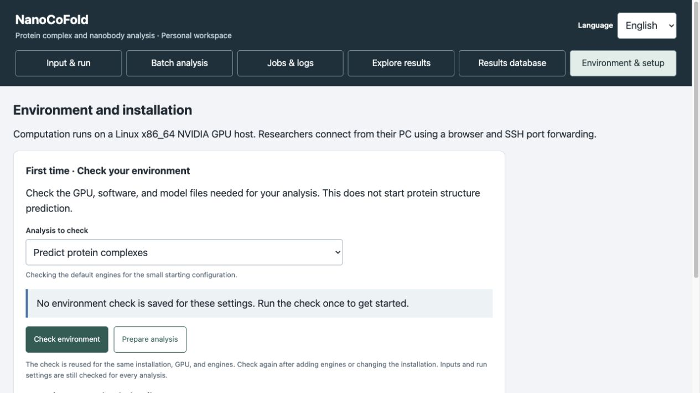
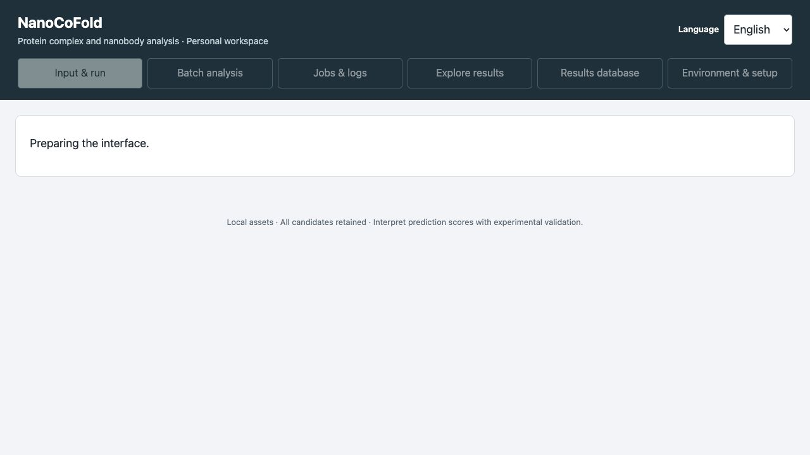
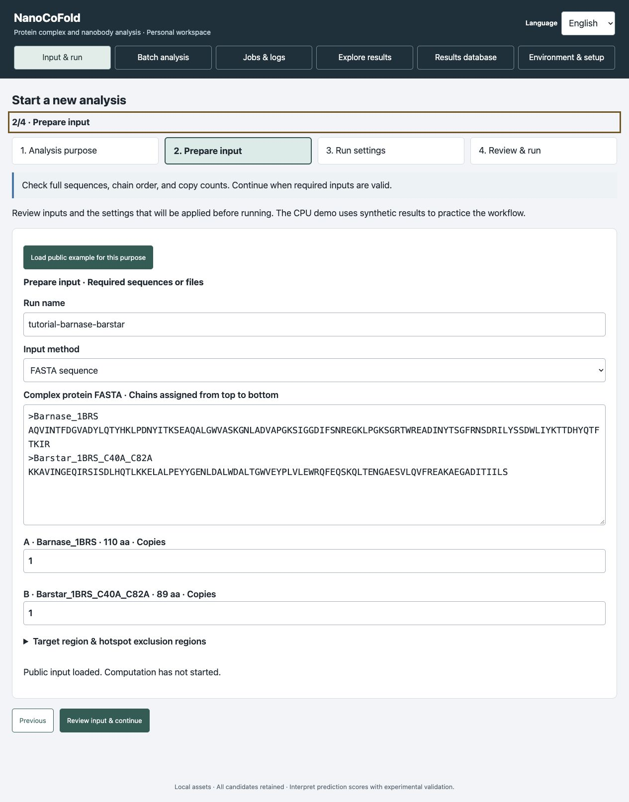
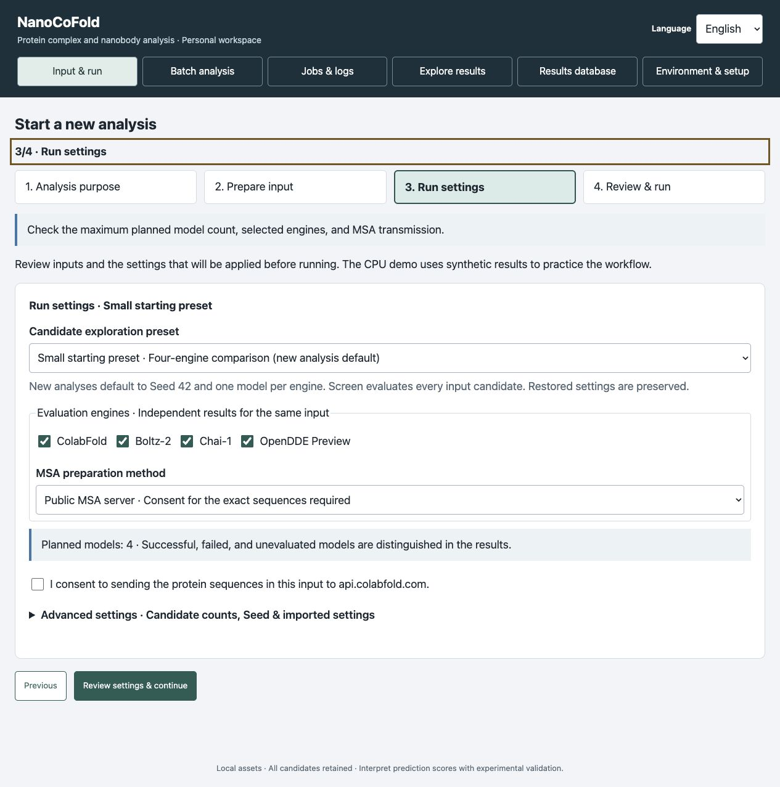
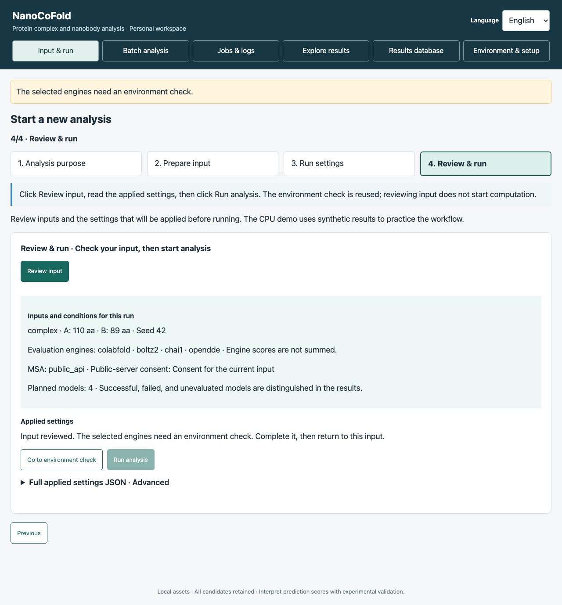
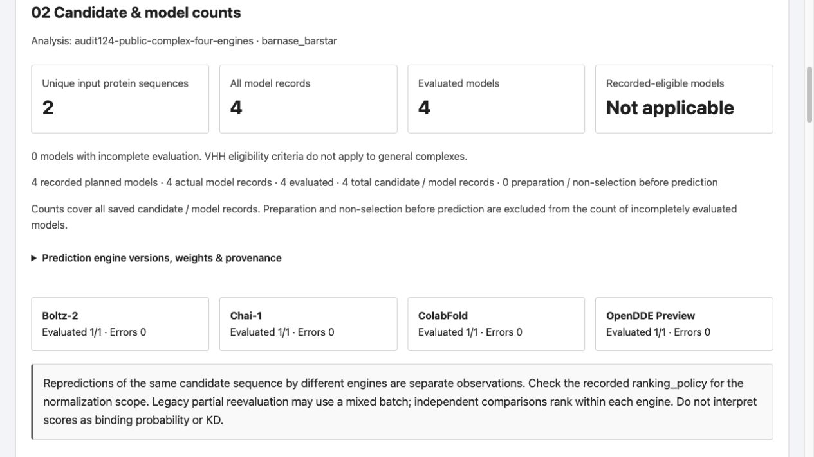
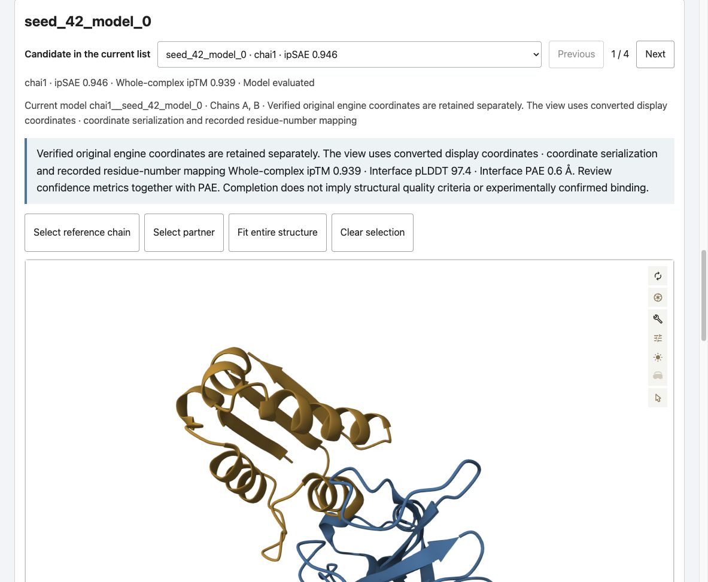
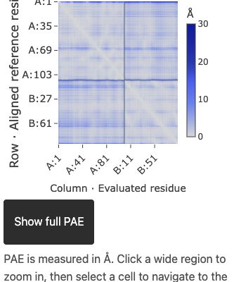
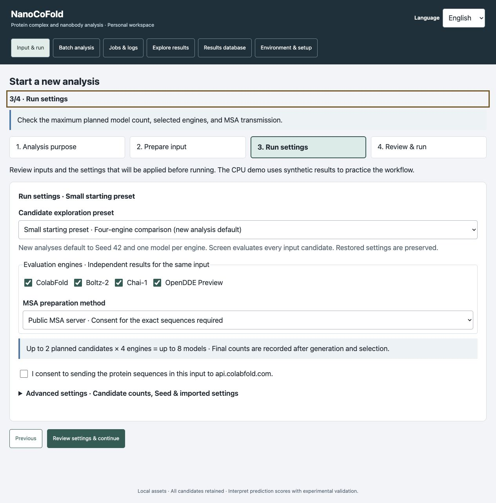
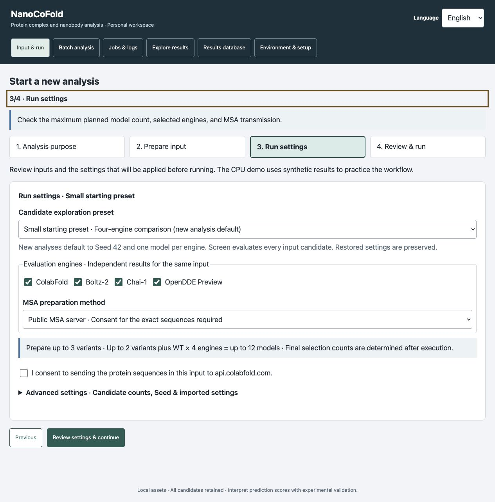

# Your first analysis in the browser

**English** · [한국어](browser_quickstart.md)

This guide follows the separate environment check and analysis workflow. Follow the [README installation steps](../README.md#1-prepare-and-install) first. If your server is already installed, start at [Open the browser](../README.md#2-open-the-browser). Use the same source folder and workspace as the installation.

Start NanoCoFold as described in the README, then open the URL printed after `NanoCoFold:` (the documented port is `18765`). The link does not launch the app, and `127.0.0.1` points to your browser computer. If another app appears, keep it running and follow the README port/SSH instructions. For a remote server, keep both the server terminal and your SSH tunnel open. Select **Language → English** to match the screenshots. If **Preparing the interface.** appears, wait for the purpose buttons. If preparation fails, read the error and click **Reload interface**.

**Already looking at “diagnostics · Complete”?** Click **Prepare analysis**, then follow the **Purpose → Input → Settings → Review → Analysis** rows below. An environment check has no protein prediction. If you already ran an analysis, use **Jobs & logs → select that analysis → Open results**; saved runs are also available under **Explore results → Select run**.

## Follow the workflow

| Stage | Action | What it means |
|---|---|---|
| Environment · once | Check environment once → select analysis → Check environment → Prepare analysis | Installation readiness only; no prediction result |
| Purpose / example | After Prepare analysis, load the public example directly. If purpose choices are shown, first choose Predict protein complexes. | Public barnase–barstar input is filled in |
| Input | Check full sequences, chain order and copies → Review input & continue | Required input is valid |
| Settings | Check engines, planned models and MSA → Review settings & continue | Public MSA needs consent for these sequences |
| Review | Review input → read the applied input and settings | Reuse a matching environment receipt |
| Analysis | Run analysis once → Jobs & logs | Prediction is submitted; inspect the analysis job |
| Results | Open results → select a candidate | Read status, structure, PAE and metrics together |

Input review does not submit analysis. A completed environment check (`diagnostics`) has no protein prediction. Reuse its receipt for the same installation, GPU and engine configuration. Review changed inputs and confirm their MSA transmission consent again.

## Follow the screenshots

**0. Check the environment once.** If **Environment ready** is already shown, click **Prepare analysis** without checking again. Otherwise, click **Check environment once** → choose the analysis → **Check environment**. Stay on this page until it passes, then click **Prepare analysis**. This check produces no protein prediction. It is reused for the same installation, GPU and engines. Adding engines or changing the installation requires another check.

**1. Confirm the purpose.** After **Prepare analysis**, **Prepare input** opens with the selected purpose already applied. Go directly to step 2; do not go back to look for a purpose button. If you started from the purpose-choice screen instead, click **Predict protein complexes · Enter input** as shown below.

**2. Load the public input.** Click **Load public example for this purpose**. The full sequences are filled in automatically. Check **Barnase: 110 aa**, **Barstar: 89 aa**, and **one copy of each**, then click **Review input & continue**.

**3. Check the settings.** Keep the small starter preset, **all four engines**, and **four planned models**. This preset uses seed **42**, **one model per engine**, **3 recycles**, and **200 diffusion steps**. Leave advanced settings unchanged for your first run. To use public MSA, give consent to send the current public sequences and click **Review settings & continue**. The screenshot shows consent **before checking the box**.

**4. Review before running.** Click **Review input**, read the applied inputs and settings, then click **Run analysis** once. A saved environment check is reused without leaving this page. If it is missing for these engines, click **Go to environment check**, complete the separate check, and click **Prepare analysis** to return to this input. The screenshot illustrates this missing-check state; no prediction was submitted. Input changes require another input review and fresh transmission consent.

**5. Read the result.** Follow **Jobs & logs → completion → Open results**. Check evaluated, failed and unevaluated counts first, then select a model. Four planned models do not guarantee four successful predictions. This screenshot shows the previously verified four-engine GPU run. **Not applicable** for VHH eligibility is normal for a general protein complex.

**6. Explore and share.** Use **Fit entire structure**, chain selection and PAE cell selection. Read each model's metrics, structure and PAE together. Save the entire **Shareable report ZIP** for collaborators. Recipients extract the whole ZIP and open **report.html** without installing NanoCoFold or using a GPU.

The English purpose and review screens (steps 1 and 4) were recaptured from version 0.4.8rc7 on 16 October 2026 using a local CPU-only browser session. The other environment/input/settings captures are preserved; see [the capture record](images/quickstart-flow/README.md). Results and purpose-specific settings retain the earlier rc5 captures and do not represent a new analysis. [Historical English capture scope and provenance](images/quickstart-rc5/en/README.md). No environment worker, MSA acquisition or GPU prediction was run for this update.

## Settings by purpose

Use **Load public example for this purpose → review input → run settings → review** for each purpose. The examples use public IL-6 inputs. Seed is **42** and each prediction engine generates **one model** per evaluated sequence. Actual generation, selection and successful prediction counts can differ from the maximum plan.

| Purpose | Required input | Small starter settings |
|---|---|---|
| Predict protein complexes | Full sequences of the proteins to predict together | Four engines → four planned models |
| Design new nanobodies | Full target sequence or structure | RFantibody 1 + BoltzGen 1, evaluated by four engines → up to eight models |
| Compare existing nanobodies | Target + full VHH sequence for each candidate | Every input VHH × four engines |
| Evaluate nanobody variants | Target + full WT VHH sequence | Prepare up to three variants; evaluate up to two plus WT with four engines → up to twelve models |

The small starter preset disables design generator prefilter rejection and the mature ESM score threshold. It retains ESM scoring, variant limits and final quality criteria. AntiFold is off in the variant example. A full VHH sequence is required; a CDR3 fragment alone is insufficient.

These small counts apply to the loaded public example. The general **Researcher exploration** preset uses `design.num_designs=1000`, `screen.tier2_n=500` and `mature.prefilter.top_n=500`; automatic target truncation is off. These are configured generation/evaluation limits, not counts of successful models. Check the planned count before using your own input. In the local browser the time-budget field is initially blank (no limit); enter a limit if needed. Read the applied settings before submission. Neither the preset nor environment-check completion guarantees successful models or binding.

Design new nanobodies: settings screenshot

Compare existing nanobodies: settings screenshot

Evaluate nanobody variants: settings screenshot

These web starter settings can differ from the preserved CLI conditions in `examples/tutorial/*_batch.json`. In particular, `library.size` does not cap DMS variants in the existing mature JSON. Use the web starter preset for the small plan shown here. The CLI DMS cap is `mature.library.max_variants`.

## Your own inputs and saved results

Choose either a structure file or a PDB ID; use **Change input method** to switch. Paste VHH/WT FASTA or import a file once. The populated FASTA is the actual input. Use **Load another file** or **Restore previous FASTA** to replace or undo an import. After restoring a draft, reselect structure files and reconfirm consent and input review. A matching installation check is reused. If you edit FASTA while a file is loading, the current input is retained and a notice is shown.

In results, select a candidate to inspect its structure. Use **Show detailed metric columns** when needed. **Save selected display coordinates** saves the displayed coordinates; **Download original engine coordinates** is available only when the original is preserved and matches its recorded hash. Preparation/preselection records are not counted as failed prediction models. Unevaluated is not zero, and low confidence is different from execution failure. The full original ZIP includes server paths/logs and is intended for personal archiving; share the report ZIP with collaborators.

## Saved files and offline reports

Use the workspace shown in the browser. Each analysis is saved under `<workspace>/runs/<job_id>/`; the job identifier is in **Jobs & logs**. When report publication succeeds, start with `report.html` in that run folder. If it links to a `report_explorer-<hash>.html` file, keep that file beside the entry page. Older reports can use `report_explorer.html`. Keep the whole report folder or ZIP together; do not rename or delete a linked explorer.

The detailed worker log is `<workspace>/.nanocofold/jobs/<job_id>/worker.log`, beside the submitted `config.yaml` snapshot. The run folder preserves `run_config.yaml`, `run_state.json` and available engine outputs. An interrupted run can contain partial results; an existing HTML file alone does not prove that the current analysis completed. Read its status and counts.

Use **Language → English / 한국어** in the browser and in newly exported interactive reports. The two languages navigate the same candidates and recorded values. IDs, sequences, coordinates, numeric data, source settings and original execution logs stay as recorded. Existing HTML snapshots keep their original renderer; export a new report to use updated language support.

## Follow jobs, cancel and resume

Changing tabs, using Back or switching language does not cancel or resubmit analysis. Return to the same job to check its status. A delayed status display is not a reason to click Run again.

In **Jobs & logs**, select the analysis job and open **Detailed execution log**. An environment-check or installation job has no protein prediction to open. A browser disconnect does not create a second submission or automatically stop a detached analysis; reopen the same workspace and inspect the existing job before clicking Run again. Keep the server and compute host available.

To stop an active analysis, use **Cancel job** and wait until cleanup changes **Cancelling** to **Cancelled**. Saved work is retained. For an interrupted, failed or cancelled analysis, resolve the logged cause and use **Verify and resume** when that action is offered. It validates the saved input/configuration and previous process ownership before restarting; it does not resume automatically. After **Time budget exhausted**, enter additional minutes when prompted. If resume is unavailable, read the log rather than submitting a duplicate run. Inspect any available partial results as partial, not as a completed analysis.

## If you get stuck

- **Continue is unavailable:** read the input error and check full sequences, chain order and required files.
- **Run analysis is unavailable:** review the input, then use Go to environment check if a matching receipt is missing. Complete that separate check and click Prepare analysis. Install missing environments as directed.
- **A request is slow or the connection drops:** check the jobs list before submitting again.
- **Only part of a structure is visible:** fit the entire structure and check chain visibility.
- **MOCK or CPU demo is shown:** these are synthetic workflow examples, not actual GPU predictions.

Failed input-review files are preserved under `inputs/failed_reviews`. Review retention needs before cleaning them. Prediction completion, quality eligibility and experimental binding are different outcomes. Do not combine engine scores into a binding probability or KD. See [result interpretation](RESULTS.md) (technical reference in Korean).
