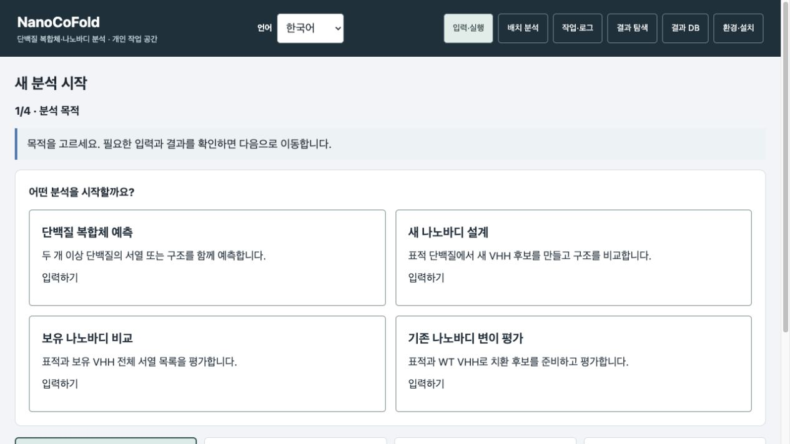
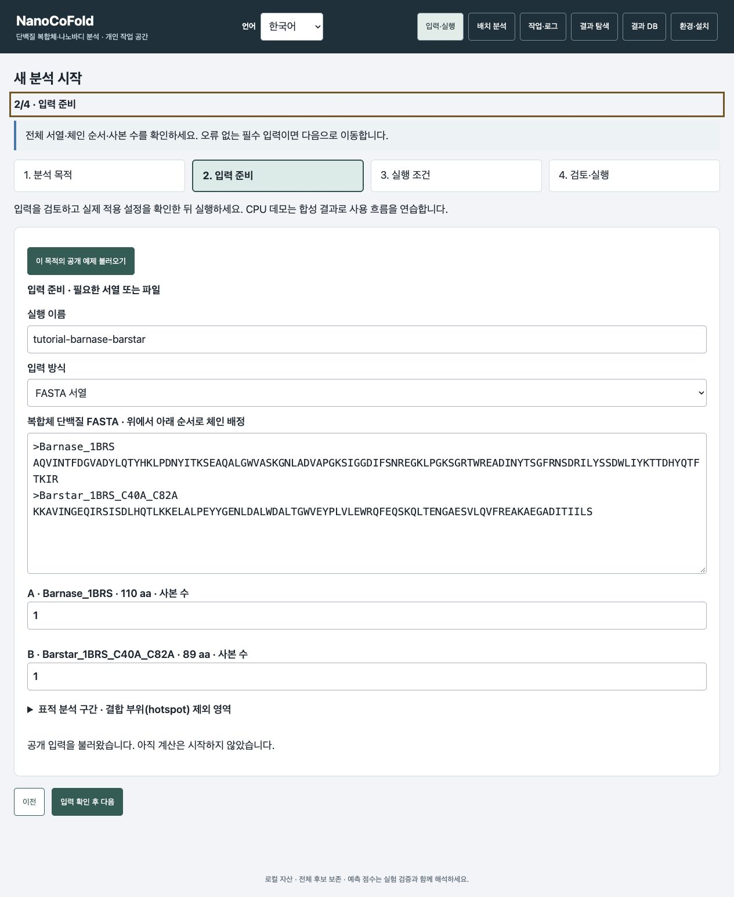
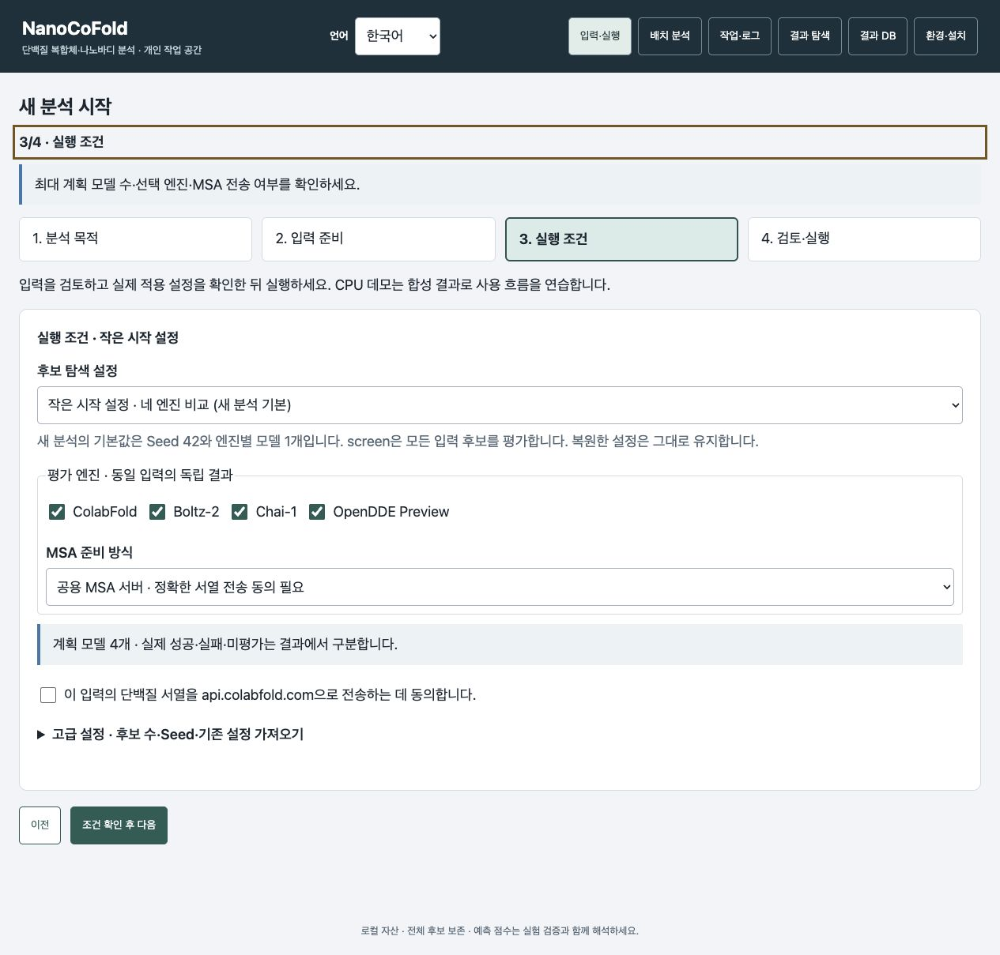
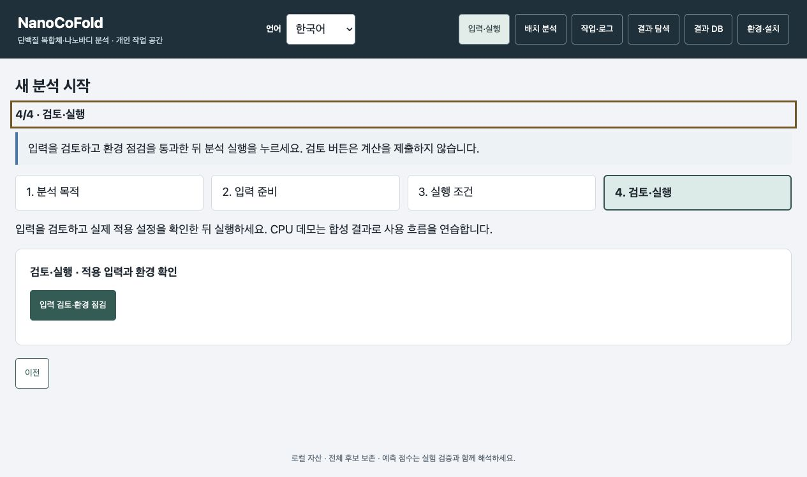

# 웹 화면에서 처음 분석하기

[English](browser_quickstart.en.md) · **한국어**

이 안내는 전달용 **v0.4.8rc5**의 네 단계 화면입니다. 설치와 서버 시작은 [한국어 README](../README.ko.md#1-준비와-설치)를 그대로 따릅니다. 이미 설치된 서버는 재설치하지 않고 [브라우저 열기](../README.ko.md#2-브라우저-열기)부터 시작하세요. 브라우저 주소는 `http://127.0.0.1:8765`입니다. 화면에 연결되지 않으면 서버 터미널과 원격 SSH 연결을 먼저 확인하세요.

상단 **Language → 한국어**로 바꾸면 아래 그림과 같은 버튼 이름을 볼 수 있습니다. 그림을 누르면 크게 볼 수 있습니다.

**화면을 준비하고 있습니다.** 동안에는 기다리세요.
준비 실패 메시지가 나타나면 원인을 확인하고 **화면 다시 불러오기**를 누릅니다.

## 처음 한 번 따라 하기

| 순서 | 화면에서 할 일 | 다음으로 갈 수 있는 상태 |
|---|---|---|
| 목적 선택 | **단백질 복합체 예측 · 입력하기** → **이 목적의 공개 예제 불러오기** | barnase–barstar 공개 입력이 채워짐 |
| 입력 준비 | 두 단백질의 전체 서열·순서·사본 수 확인 → **입력 확인 후 다음** | 필수 입력 오류가 없음 |
| 실행 조건 | 선택 엔진·계획 모델 수·MSA 방식 확인 → **조건 확인 후 다음** | 공용 MSA를 선택했다면 현재 서열 전송에 직접 동의 |
| 검토·실행 | **입력 검토·환경 점검** → 나타난 입력·조건 요약과 환경 점검 결과 확인 | 환경 점검 통과 후 **분석 실행**이 켜짐 |
| 계산 | **분석 실행**을 한 번 누름 → **작업·로그** 확인 | 완료·실패·미평가가 기록됨 |
| 결과 | **결과 열기** → 후보 표의 모델 선택 | 구조·PAE·지표를 함께 확인 가능 |

검토 버튼은 계산을 시작하지 않습니다. 실제 GPU 계산은 **분석 실행**을 누를 때 제출됩니다. 공용 MSA 동의는 현재 입력에만 적용합니다. 입력이나 조건을 고치면 검토와 환경 점검을 다시 진행하세요.

## 그림으로 따라 하기

**1. 목적 선택:** 처음에는 **단백질 복합체 예측 · 입력하기**를 누릅니다.

**2. 입력 준비:** **이 목적의 공개 예제 불러오기**를 누릅니다. Barnase **110 aa**, Barstar **89 aa**, 사본 수 **각 1개**인지 확인하고 **입력 확인 후 다음**을 누릅니다. 서열은 자동으로 채워집니다.

**3. 실행 조건:** **작은 시작 설정**, 엔진 **4개 모두 선택**, **계획 모델 4개**를 확인합니다. Seed **42**, 엔진별 **1모델**, recycle **3**, diffusion step **200**은 이 시작 설정의 값입니다. 첫 실행에서는 고급 설정을 열어 바꾸지 않아도 됩니다. 공용 MSA를 이용하려면 현재 공개 서열 전송에 직접 동의한 뒤 **조건 확인 후 다음**을 누릅니다. 아래 그림의 동의란은 체크하기 전입니다.

**4. 검토·실행:** **입력 검토·환경 점검**을 누릅니다. 나타나는 실제 입력과 설정 요약을 읽고 필요한 환경이 모두 준비됐는지 확인합니다. 통과 후 활성화된 **분석 실행**을 한 번 누르세요. 아래 그림은 **점검 전**이며 실행 승인·설치 완료를 표시한 그림이 아닙니다.

**5. 계산과 결과:** **작업·로그 → 완료 → 결과 열기** 순서로 이동합니다. 성공·실패·미평가 수를 먼저 보고 후보를 선택하세요. 아래는 앞서 실제 GPU로 계산한 네 엔진 복합체 결과입니다. 입력 그림과 동시에 새로 계산한 결과가 아닙니다. 일반 복합체의 **적격 적용 안 함**은 정상 표시입니다.

**6. 구조·PAE와 저장:** 후보를 바꾸면서 **전체 구조 보기**, 체인 선택과 **PAE 셀 선택**을 사용합니다. 모델이 바뀌면 해당 모델의 점수·구조·PAE를 함께 확인하세요. 다른 사람에게 전달할 때는 **전달용 보고서 ZIP** 전체를 저장합니다. 받는 사람은 전체 압축을 풀고 **report.html**을 엽니다.

입력·조건·검토 그림은 최신 rc5를 로컬에서 열어 촬영했고 GPU 계산을 제출하지 않았습니다. 결과 그림은 보존된 rc5 실제 GPU 결과를 읽기 전용으로 열었습니다. [촬영 범위와 이미지 출처](images/quickstart-rc5/README.md)

## 다른 목적을 사용할 때

**새 나노바디 설계**, **보유 나노바디 비교**, **기존 나노바디 변이 평가**도 같은 순서입니다. 선택한 목적의 **이 목적의 공개 예제 불러오기**를 누르면 공개 IL-6 예제가 채워집니다.

| 목적 | 필요한 입력 | 작은 시작 설정의 최대 계획 |
|---|---|---|
| complex | 함께 예측할 단백질들의 전체 서열 | 같은 복합체 × 네 엔진 = 4모델 |
| design | 표적 전체 서열 또는 구조 | RFantibody 1개 + BoltzGen 1개 × 네 엔진 = 최대 8모델 |
| screen | 표적 + 후보마다 전체 VHH | 입력 VHH 전체 × 네 엔진 |
| mature | 표적 + WT 전체 VHH | 변이 3개 준비 → 최대 2개와 WT × 네 엔진 = 최대 12모델 |

작은 시작 설정은 design의 생성기 사전필터와 mature의 ESM 점수 문턱을 끕니다. 적은 후보의 구조를 모두 살펴보기 위한 조건이며 ESM 점수 계산·변이 수 제한·최종 품질 선별은 유지합니다.

Seed는 42, 엔진별 모델은 1개입니다. 실제 생성·선별·예측 성공 수는 계획 수와 다를 수 있으며 결과에 별도로 기록됩니다. 필요한 입력 칸만 채우세요. **고급 설정**은 조건을 바꿔야 할 때만 펼칩니다.

## 목적별 설정 스냅샷

각 목적에서도 **공개 예제 불러오기 → 입력 확인 → 실행 조건 → 검토** 순서입니다. 아래 그림은 계산 전 실제 기본 설정 화면입니다.

| 목적 | 처음에 확인할 값 | 손대지 않아도 되는 값 |
|---|---|---|
| 새 나노바디 설계 | RFantibody 1개 + BoltzGen 1개, 네 예측 엔진 → 최대 8모델 | Seed 42, 생성기 사전필터 끔, 최종 품질 기준 유지 |
| 보유 나노바디 비교 | 표적 전체 서열 + 후보별 전체 VHH, 네 엔진 → 후보 수 × 4모델 | Seed 42, 후보 누락 없이 모든 입력 후보 평가 |
| 기존 나노바디 변이 평가 | WT 전체 VHH, 변이 최대 3개 준비, 최대 2개와 WT를 네 엔진으로 평가 → 최대 12모델 | Seed 42, AntiFold 끔, ESM 계산 유지·점수 문턱 끔, 최종 품질 기준 유지 |

새 나노바디 설계의 실행 조건 보기

보유 나노바디 비교의 실행 조건 보기

기존 나노바디 변이 평가의 실행 조건 보기

여기의 작은 시작 설정과 `examples/tutorial/*_batch.json`의 보존된 CLI 조건은 다를 수 있습니다. 특히 기존 mature JSON의 `library.size`는 DMS 변이 상한이 아닙니다. 위 그림처럼 적게 시작하려면 웹의 작은 시작 설정을 사용하세요. CLI의 DMS 상한은 `mature.library.max_variants`로 지정합니다.

## 입력을 바꾸거나 파일을 사용할 때

구조 파일과 PDB ID 중 하나만 사용합니다. 선택하면 다른 입력 칸은 접히며 **입력 방식 바꾸기**로 전환합니다.
VHH·WT FASTA는 직접 입력 또는 파일 불러오기 중 하나입니다. 한 번 채워지면 그 FASTA를 그대로 사용하므로 파일을 또 넣지 않습니다.
**다른 파일 불러오기**로 바꾸고 **이전 FASTA 복원**으로 되돌릴 수 있습니다.
파일을 읽는 동안 직접 서열을 수정했다면 현재 입력을 유지하며 알림을 표시합니다.
초안 복원 시 구조 파일과 전송 동의는 다시 확인하고 검토를 새로 진행합니다.

## 결과에서 무엇을 누르나?

1. 성공·실패·미평가 수와 경고를 확인합니다. 전체 후보 기록과 실제 모델 기록은 구분하며, 예측 전 준비·미선정은 모델 실패로 세지 않습니다. 낮은 신뢰도와 실행 실패는 다른 상태입니다.
2. 후보 표의 행을 누르고 해당 엔진의 구조를 봅니다. 처음에는 핵심 열만 표시합니다. 필요하면 **상세 지표 열 펼치기**를 체크합니다.
3. **전체 구조 보기/맞춤**으로 복합체 전체를 봅니다. **표적 선택/나노바디 선택**으로 각 체인을 확대합니다. complex에서는 **기준 체인 선택/파트너 선택**입니다. **선택 해제**로 강조를 지웁니다. 체크박스는 체인의 표시·숨김을 바꿉니다.
4. PAE 셀을 누르면 잔기 쌍이 선택되고 3D 뷰어로 이동합니다. 구조와 같은 엔진의 ipTM·계면 pLDDT·계면 PAE를 함께 읽습니다.
5. 표·서열·좌표를 저장합니다. **선택 예측 구조 저장**은 표시 좌표, **원본 엔진 좌표 다운로드**는 보고서에 보존된 원본 파일입니다. 원본이 없으면 버튼을 사용할 수 없습니다.
6. 전달하려면 보고서 ZIP 전체를 저장합니다. 받는 사람은 전체 압축을 풀고 **`report.html`**을 엽니다. 여러 보고서를 모은 묶음만 별도 시작 목차를 제공합니다.

## 막혔을 때

입력 검토에 실패한 파일과 기록은 `inputs/failed_reviews`에 자동 보존되므로 디스크 여유를 확인하고 관리자가 보존 필요성을 검토한 뒤 정리합니다.

- **다음 버튼이 안 켜짐:** 화면의 입력 오류를 읽고 전체 서열·체인 순서·필수 파일을 확인합니다.
- **분석 실행이 안 켜짐:** 입력 검토와 환경 점검 결과를 확인합니다. 빠진 환경은 설치 안내에 따라 준비합니다.
- **응답이 늦거나 연결이 끊김:** 작업 목록을 먼저 열어 기존 제출을 확인합니다. 같은 작업을 새로 제출하지 않습니다.
- **구조가 일부만 보임:** 전체 구조 보기와 체인 표시를 확인합니다. 체인 확대는 선택한 체인을 중심으로 보는 기능입니다.
- **MOCK 또는 CPU 데모 표시:** 합성 데이터로 화면 흐름을 보여 주는 결과입니다. 실제 GPU 예측이나 실험 결과로 읽지 않습니다.

계산 완료·품질 선별·실제 결합은 다른 상태입니다. 점수를 합쳐 엔진 간 순위를 만들거나 KD·생물학적 효능으로 환산하지 않습니다. [결과 해석 안내](RESULTS.md)
