# 웹 화면에서 처음 분석하기

[English](browser_quickstart.en.md) · **한국어**

이 안내는 별도 환경 확인과 분석 실행 흐름을 따릅니다. 설치와 서버 시작은 [한국어 README](../README.ko.md#1-준비와-설치)를 그대로 따릅니다. 이미 설치된 서버는 재설치하지 않고 [브라우저 열기](../README.ko.md#2-브라우저-열기)부터 시작하세요. 먼저 README의 명령으로 NanoCoFold를 시작하고 터미널의 `NanoCoFold:` 다음 주소를 엽니다(안내 포트 `18765`). 링크만 누르면 앱이 실행되는 것은 아닙니다. `127.0.0.1`은 브라우저 PC이므로 다른 앱이 보이면 그 앱을 유지하고 README의 포트·SSH 안내를 따르세요. 화면에 연결되지 않으면 서버 터미널과 원격 SSH 연결을 먼저 확인하세요.

상단 **Language → 한국어**로 바꾸면 아래 그림과 같은 버튼 이름을 볼 수 있습니다. 그림을 누르면 크게 볼 수 있습니다.

**화면을 준비하고 있습니다.** 동안에는 기다리세요.
준비 실패 메시지가 나타나면 원인을 확인하고 **화면 다시 불러오기**를 누릅니다.

**지금 “diagnostics · 완료” 화면인가요?** **분석 준비하기**를 누른 뒤 아래 **목적 → 입력 → 조건 → 검토 → 계산**을 따라 하세요. 환경 확인에는 단백질 예측 결과가 없습니다. 이미 분석을 실행했다면 **작업·로그 → 해당 분석 선택 → 결과 열기**로 확인합니다. 저장 결과는 **결과 탐색 → 실행 선택**에서도 엽니다.

## 처음 한 번 따라 하기

| 순서 | 화면에서 할 일 | 다음으로 갈 수 있는 상태 |
|---|---|---|
| 환경 · 처음 한 번 | **처음 한 번 환경 확인** → 분석 목적 선택 → **환경 확인 시작** | 같은 화면에서 완료를 기다린 뒤 **분석 준비하기** |
| 목적·예제 | **분석 준비하기** 다음에는 바로 **이 목적의 공개 예제 불러오기**. 목적 버튼들이 보일 때만 먼저 **단백질 복합체 예측 · 입력하기** 선택 | barnase–barstar 공개 입력이 채워짐 |
| 입력 준비 | 두 단백질의 전체 서열·순서·사본 수 확인 → **입력 확인 후 다음** | 필수 입력 오류가 없음 |
| 실행 조건 | 선택 엔진·계획 모델 수·MSA 방식 확인 → **조건 확인 후 다음** | 공용 MSA를 선택했다면 현재 서열 전송에 직접 동의 |
| 검토·실행 | **입력 확인** → 적용 입력·조건 요약 확인 | 저장된 환경 기록 재사용 → **분석 실행** |
| 계산 | **분석 실행**을 한 번 누름 → **작업·로그** 확인 | 완료·실패·미평가가 기록됨 |
| 결과 | **결과 열기** → 후보 표의 모델 선택 | 구조·PAE·지표를 함께 확인 가능 |

검토 버튼은 계산을 시작하지 않습니다. 실제 GPU 계산은 **분석 실행**을 누를 때 제출됩니다. 공용 MSA 동의는 현재 입력에만 적용합니다. 입력이나 조건을 고치면 입력 검토와 전송 동의를 다시 확인하세요. 설치·GPU·선택 엔진 구성이 같으면 환경 확인은 반복하지 않습니다.

## 그림으로 따라 하기

**0. 환경 확인 · 처음 한 번:** 이미 **환경 확인 완료**라면 새 확인 없이 **분석 준비하기**를 누릅니다. 기록이 없다면 **처음 한 번 환경 확인** → 분석 목적 → **환경 확인 시작**을 누릅니다. 이 화면에서 완료를 기다린 뒤 **분석 준비하기**를 누릅니다. 환경 확인은 구조 예측 결과를 만들지 않습니다.

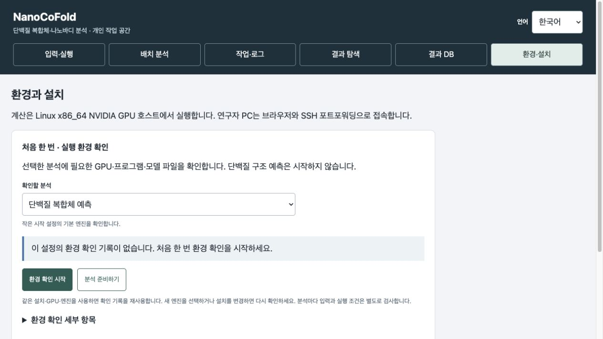

**1. 목적 확인:** **분석 준비하기**를 누르면 선택한 목적의 **입력 준비** 화면이 열립니다. 목적 버튼을 찾으러 돌아가지 말고 바로 2번으로 갑니다. 목적 선택 화면에서 시작했다면 아래처럼 **단백질 복합체 예측 · 입력하기**를 누릅니다.

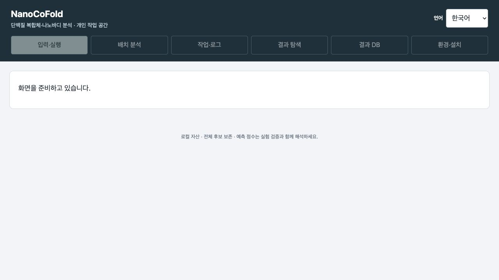

**2. 입력 준비:** **이 목적의 공개 예제 불러오기**를 누릅니다. Barnase **110 aa**, Barstar **89 aa**, 사본 수 **각 1개**인지 확인하고 **입력 확인 후 다음**을 누릅니다. 서열은 자동으로 채워집니다.

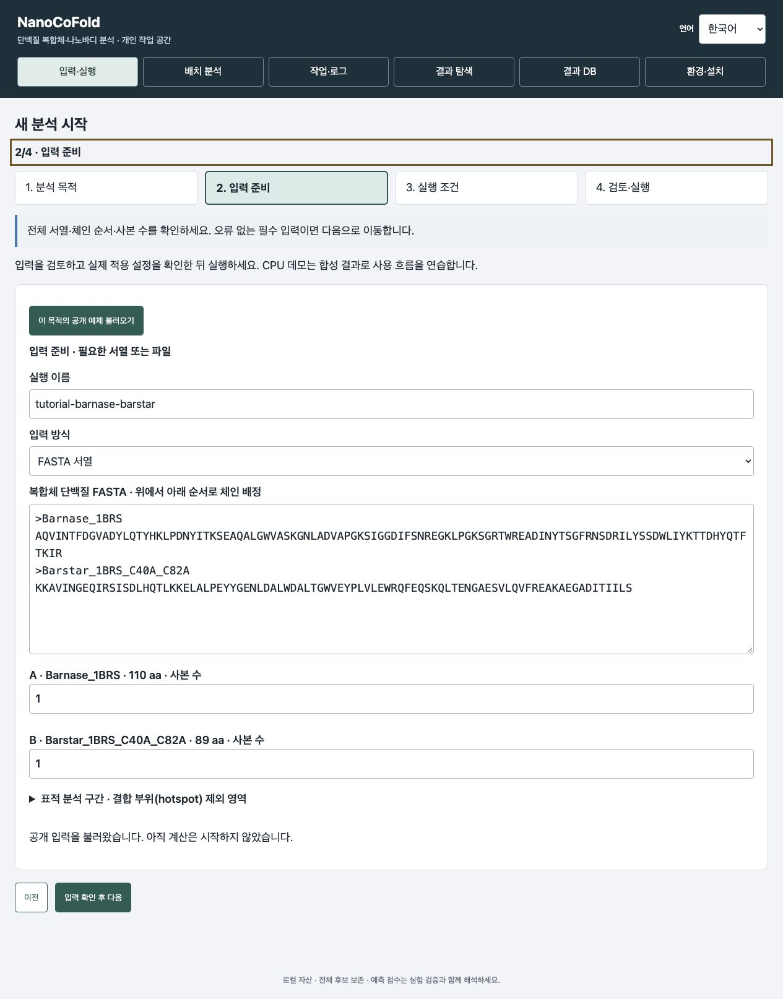

**3. 실행 조건:** **작은 시작 설정**, 엔진 **4개 모두 선택**, **계획 모델 4개**를 확인합니다. Seed **42**, 엔진별 **1모델**, recycle **3**, diffusion step **200**은 이 시작 설정의 값입니다. 첫 실행에서는 고급 설정을 열어 바꾸지 않아도 됩니다. 공용 MSA를 이용하려면 현재 공개 서열 전송에 직접 동의한 뒤 **조건 확인 후 다음**을 누릅니다. 아래 그림의 동의란은 체크하기 전입니다.

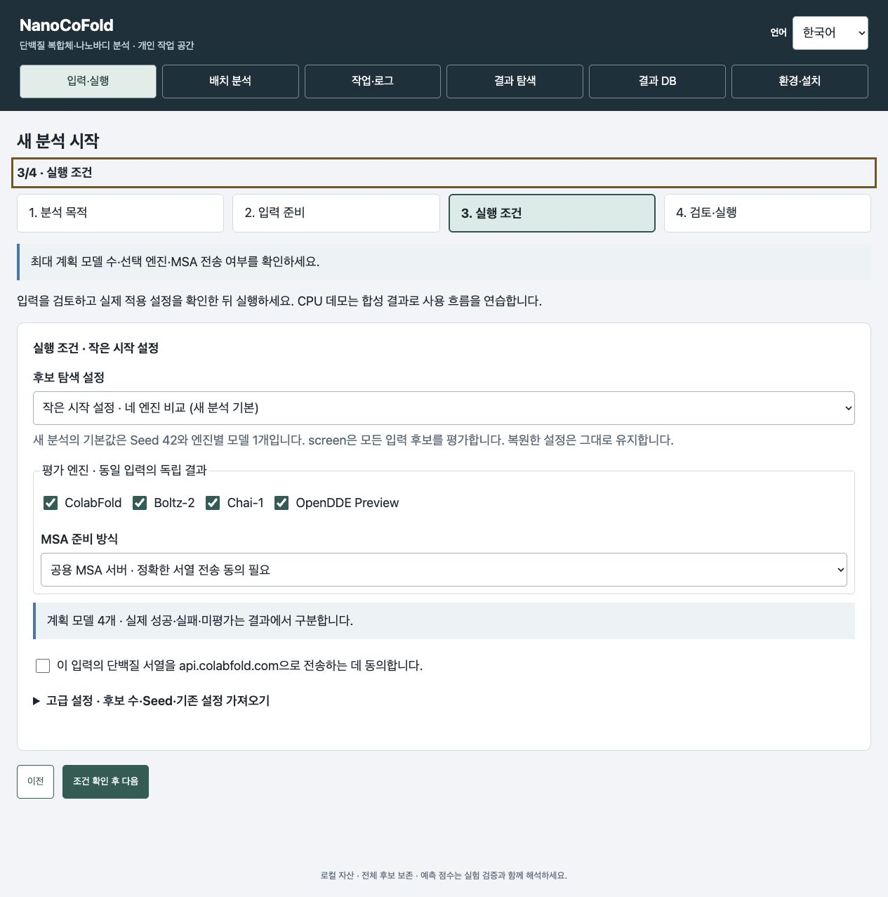

**4. 검토·실행:** **입력 확인**을 누른 뒤 나타나는 입력과 설정 요약을 읽습니다. 저장된 환경 확인 기록이 있으면 같은 화면에서 **분석 실행**을 누르면 됩니다. 기록이 없다면 **환경 확인으로 이동** → 별도 확인 완료 → **분석 준비하기**로 이 입력에 돌아옵니다. 아래는 확인 기록이 없어 실행이 잠긴 경우이며, 캡처 중 계산은 제출하지 않았습니다.

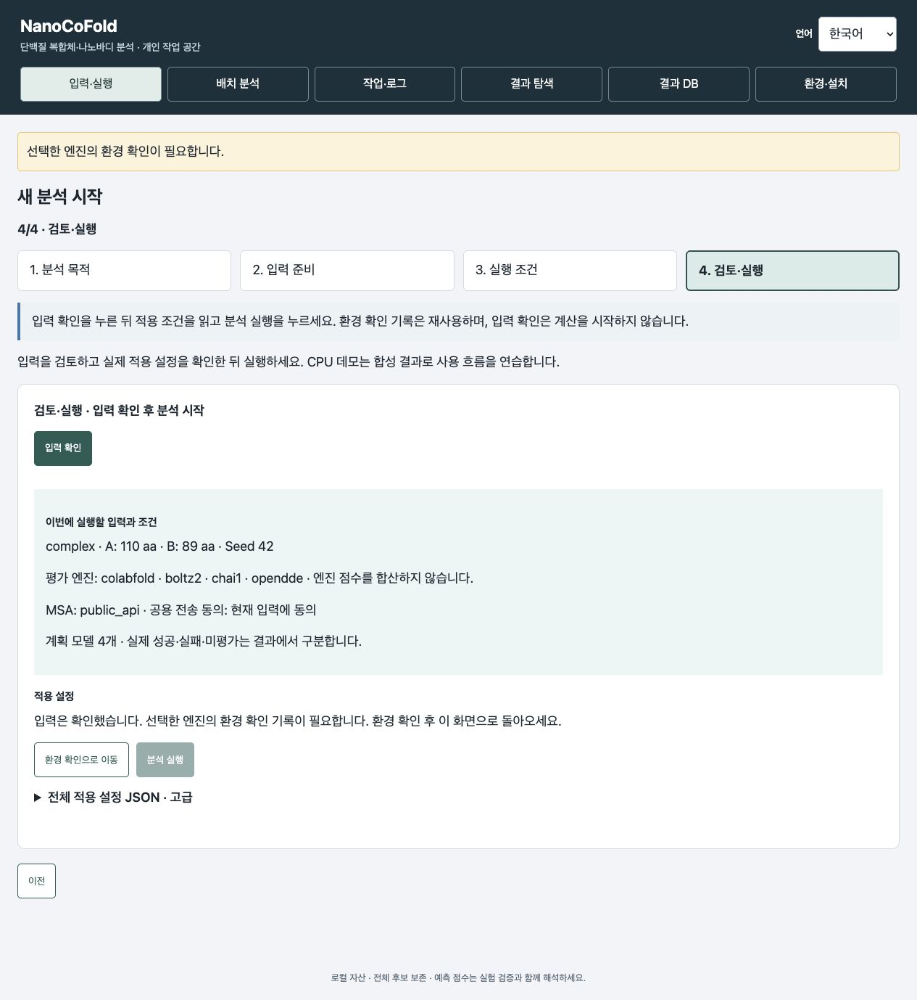

**5. 계산과 결과:** **작업·로그 → 완료 → 결과 열기** 순서로 이동합니다. 성공·실패·미평가 수를 먼저 보고 후보를 선택하세요. 아래는 앞서 실제 GPU로 계산한 네 엔진 복합체 결과입니다. 입력 그림과 동시에 새로 계산한 결과가 아닙니다. 일반 복합체의 **적격 적용 안 함**은 정상 표시입니다.

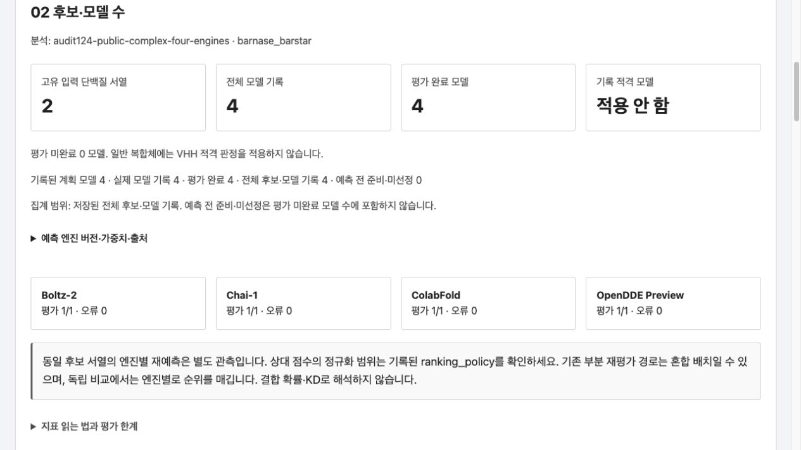

**6. 구조·PAE와 저장:** 후보를 바꾸면서 **전체 구조 보기**, 체인 선택과 **PAE 셀 선택**을 사용합니다. 모델이 바뀌면 해당 모델의 점수·구조·PAE를 함께 확인하세요. 다른 사람에게 전달할 때는 **전달용 보고서 ZIP** 전체를 저장합니다. 받는 사람은 전체 압축을 풀고 **report.html**을 엽니다.

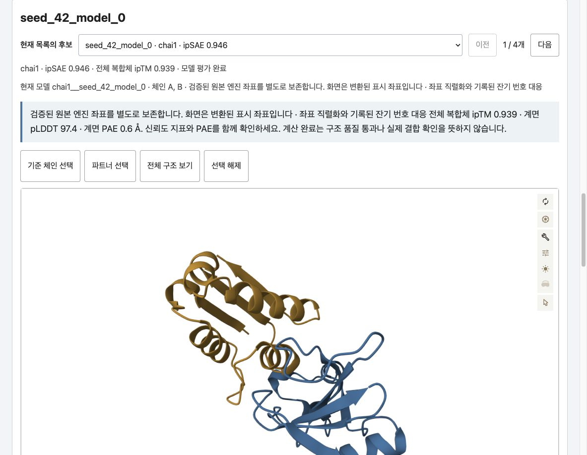

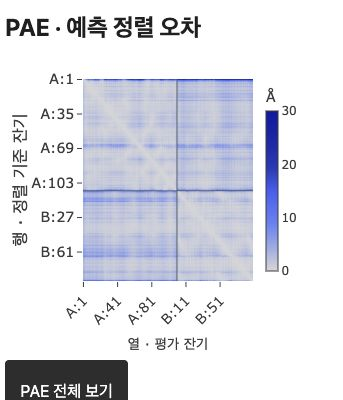

영어 안내의 목적 선택·검토 화면(1·4단계)은 2026년 10월 16일 버전 0.4.8rc7의 로컬 CPU 브라우저에서 다시 촬영했습니다. 이 한국어 안내와 나머지 환경·입력·조건 그림은 보존된 캡처이며 [촬영 기록](images/quickstart-flow/README.md)을 따릅니다. 결과와 목적별 설정 그림은 새 분석이 아닌 기존 rc5 캡처입니다. [기존 한국어 촬영 범위와 출처](images/quickstart-rc5/README.md). 이번 갱신에서는 환경 확인 작업·MSA 수집·GPU 예측을 실행하지 않았습니다.

## 다른 목적을 사용할 때

**새 나노바디 설계**, **보유 나노바디 비교**, **기존 나노바디 변이 평가**도 같은 순서입니다. 선택한 목적의 **이 목적의 공개 예제 불러오기**를 누르면 공개 IL-6 예제가 채워집니다.

| 목적 | 필요한 입력 | 작은 시작 설정의 최대 계획 |
|---|---|---|
| complex | 함께 예측할 단백질들의 전체 서열 | 같은 복합체 × 네 엔진 = 4모델 |
| design | 표적 전체 서열 또는 구조 | RFantibody 1개 + BoltzGen 1개 × 네 엔진 = 최대 8모델 |
| screen | 표적 + 후보마다 전체 VHH | 입력 VHH 전체 × 네 엔진 |
| mature | 표적 + WT 전체 VHH | 변이 3개 준비 → 최대 2개와 WT × 네 엔진 = 최대 12모델 |

작은 시작 설정은 design의 생성기 사전필터와 mature의 ESM 점수 문턱을 끕니다. 적은 후보의 구조를 모두 살펴보기 위한 조건이며 ESM 점수 계산·변이 수 제한·최종 품질 선별은 유지합니다. 변이 예제의 AntiFold는 꺼져 있습니다. VHH 전체 서열이 필요하며 CDR3 조각만으로 대체하지 않습니다.

이 작은 수량은 불러온 공개 예제의 값입니다. 일반 **연구자 탐색** 설정은 `design.num_designs=1000`, `screen.tier2_n=500`, `mature.prefilter.top_n=500`을 사용하며 표적 자동 절단은 꺼져 있습니다. 이 값은 생성·평가 조건의 상한이며 성공한 모델 수가 아닙니다. 자신의 입력을 넣기 전에 계획 모델 수를 확인하세요. 로컬 브라우저의 시간 한도는 처음에 빈칸(제한 없음)이므로 필요하면 직접 넣습니다. 제출 전 적용 설정을 읽으세요. 설정 선택이나 환경 확인 완료가 예측 성공 또는 결합을 보장하지 않습니다.

Seed는 42, 엔진별 모델은 1개입니다. 실제 생성·선별·예측 성공 수는 계획 수와 다를 수 있으며 결과에 별도로 기록됩니다. 필요한 입력 칸만 채우세요. **고급 설정**은 조건을 바꿔야 할 때만 펼칩니다.

## 목적별 설정 스냅샷

각 목적에서도 **공개 예제 불러오기 → 입력 확인 → 실행 조건 → 검토** 순서입니다. 아래 그림은 계산 전 실제 기본 설정 화면입니다.

| 목적 | 처음에 확인할 값 | 손대지 않아도 되는 값 |
|---|---|---|
| 새 나노바디 설계 | RFantibody 1개 + BoltzGen 1개, 네 예측 엔진 → 최대 8모델 | Seed 42, 생성기 사전필터 끔, 최종 품질 기준 유지 |
| 보유 나노바디 비교 | 표적 전체 서열 + 후보별 전체 VHH, 네 엔진 → 후보 수 × 4모델 | Seed 42, 후보 누락 없이 모든 입력 후보 평가 |
| 기존 나노바디 변이 평가 | WT 전체 VHH, 변이 최대 3개 준비, 최대 2개와 WT를 네 엔진으로 평가 → 최대 12모델 | Seed 42, AntiFold 끔, ESM 계산 유지·점수 문턱 끔, 최종 품질 기준 유지 |

새 나노바디 설계의 실행 조건 보기

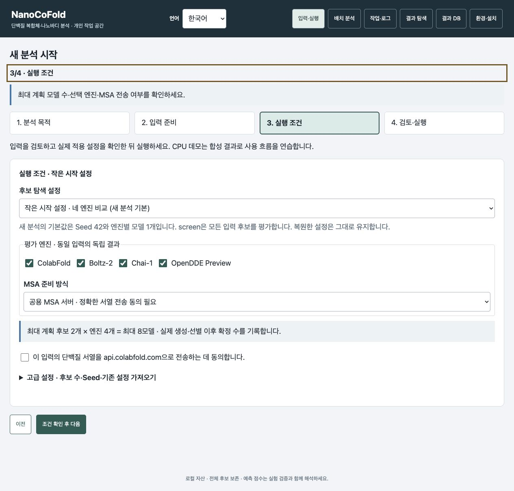

보유 나노바디 비교의 실행 조건 보기

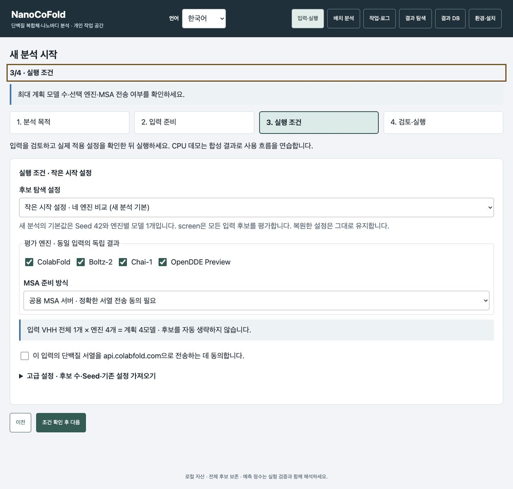

기존 나노바디 변이 평가의 실행 조건 보기

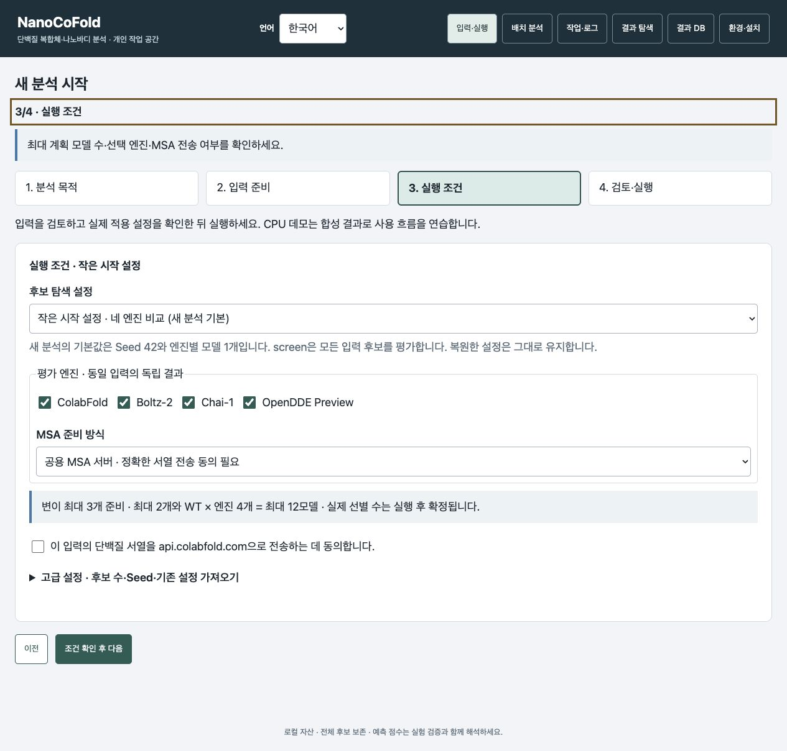

여기의 작은 시작 설정과 `examples/tutorial/*_batch.json`의 보존된 CLI 조건은 다를 수 있습니다. 특히 기존 mature JSON의 `library.size`는 DMS 변이 상한이 아닙니다. 위 그림처럼 적게 시작하려면 웹의 작은 시작 설정을 사용하세요. CLI의 DMS 상한은 `mature.library.max_variants`로 지정합니다.

## 입력을 바꾸거나 파일을 사용할 때

구조 파일과 PDB ID 중 하나만 사용합니다. 선택하면 다른 입력 칸은 접히며 **입력 방식 바꾸기**로 전환합니다.
VHH·WT FASTA는 직접 입력 또는 파일 불러오기 중 하나입니다. 한 번 채워지면 그 FASTA를 그대로 사용하므로 파일을 또 넣지 않습니다.
**다른 파일 불러오기**로 바꾸고 **이전 FASTA 복원**으로 되돌릴 수 있습니다.
파일을 읽는 동안 직접 서열을 수정했다면 현재 입력을 유지하며 알림을 표시합니다.
초안을 복원하면 구조 파일·전송 동의·입력 검토를 다시 확인합니다. 같은 설치의 환경 확인 기록은 재사용합니다.

## 결과에서 무엇을 누르나?

1. 성공·실패·미평가 수와 경고를 확인합니다. 전체 후보 기록과 실제 모델 기록은 구분하며, 예측 전 준비·미선정은 모델 실패로 세지 않습니다. 낮은 신뢰도와 실행 실패는 다른 상태입니다.
2. 후보 표의 행을 누르고 해당 엔진의 구조를 봅니다. 처음에는 핵심 열만 표시합니다. 필요하면 **상세 지표 열 펼치기**를 체크합니다.
3. **전체 구조 보기/맞춤**으로 복합체 전체를 봅니다. **표적 선택/나노바디 선택**으로 각 체인을 확대합니다. complex에서는 **기준 체인 선택/파트너 선택**입니다. **선택 해제**로 강조를 지웁니다. 체크박스는 체인의 표시·숨김을 바꿉니다.
4. PAE 셀을 누르면 잔기 쌍이 선택되고 3D 뷰어로 이동합니다. 구조와 같은 엔진의 ipTM·계면 pLDDT·계면 PAE를 함께 읽습니다.
5. 표·서열·좌표를 저장합니다. **선택 예측 구조 저장**은 표시 좌표, **원본 엔진 좌표 다운로드**는 보고서에 보존된 원본 파일입니다. 원본이 없거나 기록된 해시와 맞지 않으면 버튼을 사용할 수 없습니다. 원본과 표시 좌표의 관계는 출처 안내를 확인합니다.
6. 전달하려면 보고서 ZIP 전체를 저장합니다. 받는 사람은 전체 압축을 풀고 **`report.html`**을 엽니다. 여러 보고서를 모은 묶음만 별도 시작 목차를 제공합니다.

전체 원본 ZIP은 서버 경로와 로그를 포함하므로 개인 보관·복구에 사용합니다. 공동연구자에게는 전달용 보고서 ZIP 전체를 보냅니다. 일반 PC에서 GPU나 NanoCoFold 설치 없이 압축을 풀어 읽을 수 있습니다.

## 보고서는 여섯 구간 순서로 읽으세요

| 구간 | 확인할 내용 |
|---|---|
| 01 입력·설정 | 의도한 서열과 조건으로 실행했는지 확인합니다. |
| 02 후보·모델 수 | 완료·실패·미평가 모델을 구분합니다. 일반 복합체에는 VHH 적격성 필터를 적용하지 않습니다. |
| 03 후보 비교 | 후보·모델과 예측 엔진을 선택하고 기록된 점수를 읽습니다. |
| 04 제외·미평가 | 선별 0건이면 평가 후 기준에 걸린 경우와 평가 자체를 못 한 경우를 구분합니다. 어느 경우도 실제로 결합하지 않는다는 측정 결과는 아닙니다. |
| 05 구조·PAE | 선택한 모델의 구조와 잔기 상대 배치의 불확실성을 함께 봅니다. |
| 06 출처·산출물 | 기록된 조건을 확인하고 필요한 보고서·데이터를 저장합니다. |

구간 링크는 같은 보고서 안에서 이동합니다. 브라우저 **뒤로 / 앞으로**는 이전 구간이나 화면으로 이동할 뿐 분석을 제출·취소·재시작하지 않습니다. 언어를 비교할 때는 같은 후보를 선택해 두세요.

위 단계는 로컬 설치 앱의 버튼 이름을 사용합니다. 관리자가 제공한 운영 사이트에서는 **작업 목록**, **보고서·출처**, **오프라인 HTML**, **검증된 단계 재개**로 표시될 수 있습니다. 현재 언어의 보고서는 **오프라인 HTML**로 받습니다. 이전 계산 에이전트가 안전한 재개를 지원하지 않으면 재개 버튼이 잠길 수 있습니다. 표시된 이유를 확인하고 관리자에게 문의하며, 같은 작업을 중복 제출하지 마세요.

## 저장 파일과 오프라인 보고서

브라우저에 표시된 작업 공간을 기준으로 찾습니다. 분석별 폴더는 `<workspace>/runs/<job_id>/`이며, 작업 ID는 **작업·로그**에서 확인합니다. 보고서 발행이 성공하면 그 폴더의 `report.html`부터 엽니다. `report_explorer-<hash>.html`로 연결되는 보고서는 해당 파일도 옆에 둡니다. 이전 보고서는 `report_explorer.html`을 사용할 수 있습니다. 폴더나 ZIP 전체를 함께 보관하고 연결된 탐색기 파일을 바꾸거나 지우지 마세요.

상세 worker 로그는 `<workspace>/.nanocofold/jobs/<job_id>/worker.log`, 제출한 설정 사본은 같은 폴더의 `config.yaml`입니다. 분석 폴더에는 `run_config.yaml`, `run_state.json`과 보존된 엔진 산출물이 있습니다. 중단된 분석에는 부분 결과가 남을 수 있으며, HTML이 있다는 사실만으로 현재 분석이 완료됐다고 판단하지 않습니다. 상태와 모델 수를 함께 읽으세요.

브라우저와 새로 내보낸 대화형 보고서에서 **Language → English / 한국어**로 바꿉니다. 두 언어는 같은 후보와 기록된 값을 탐색합니다. ID·서열·좌표·수치·원본 설정·실행 로그는 기록 그대로 유지합니다. 예전에 저장한 HTML과 보고서 ZIP은 생성 당시 화면과 언어 지원을 유지합니다. 이전 ZIP을 다시 내려받아도 최신 화면으로 변환되지는 않습니다. 현재 언어 지원이 필요하면 앱이 제공하는 최신 보고서 보기·내보내기를 사용하고, 이전 원본 묶음과 과학 기록은 그대로 보관하세요.

## 작업 확인·중단·재개

탭 이동·뒤로가기·언어 전환은 분석을 취소하거나 다시 제출하지 않습니다. 같은 작업으로 돌아가 상태를 확인하세요. 상태 표시가 늦다고 분석 실행을 다시 누르지 않습니다.

**작업·로그**에서 분석 작업을 선택하고 **상세 실행 로그**를 엽니다. 환경 확인·설치 작업에는 열 수 있는 단백질 예측 결과가 없습니다. 브라우저 연결이 끊겼다고 분석이 다시 제출되거나 분리된 분석이 자동 종료되지는 않습니다. 같은 작업 공간을 다시 열고 기존 작업부터 확인하세요. 서버와 계산 호스트는 유지합니다.

실행 중인 분석을 멈추려면 **작업 취소**를 누르고 종료 정리가 끝나 **취소 중 → 취소**로 바뀔 때까지 기다립니다. 저장된 작업은 보존합니다. 중단·실패·취소된 분석은 로그의 원인을 해결하고 버튼이 제공될 때 **검증 후 재개**를 사용합니다. 저장 입력·설정과 이전 프로세스 소유권을 검증한 뒤 실행하며 자동으로 재시작하지 않습니다. **시간 소진** 상태에서는 안내에 따라 추가 시간을 분 단위로 넣습니다. 재개가 불가능하면 같은 분석을 중복 제출하지 말고 로그를 확인하세요. 남아 있는 부분 결과는 전체 분석 완료와 구분해서 읽습니다.

## 막혔을 때

입력 검토에 실패한 파일과 기록은 `inputs/failed_reviews`에 자동 보존되므로 디스크 여유를 확인하고 관리자가 보존 필요성을 검토한 뒤 정리합니다.

- **다음 버튼이 안 켜짐:** 화면의 입력 오류를 읽고 전체 서열·체인 순서·필수 파일을 확인합니다.
- **분석 실행이 안 켜짐:** 입력을 검토하고 일치하는 기록이 없다면 환경 확인으로 이동합니다. 별도 확인을 마친 뒤 분석 준비하기로 돌아옵니다. 빠진 환경은 설치 안내에 따라 준비합니다.
- **응답이 늦거나 연결이 끊김:** 작업 목록을 먼저 열어 기존 제출을 확인합니다. 같은 작업을 새로 제출하지 않습니다.
- **구조가 일부만 보임:** 전체 구조 보기와 체인 표시를 확인합니다. 체인 확대는 선택한 체인을 중심으로 보는 기능입니다.
- **MOCK 또는 CPU 데모 표시:** 합성 데이터로 화면 흐름을 보여 주는 결과입니다. 실제 GPU 예측이나 실험 결과로 읽지 않습니다.

계산 완료·품질 선별·실제 결합은 다른 상태입니다. 점수를 합쳐 엔진 간 순위를 만들거나 KD·생물학적 효능으로 환산하지 않습니다. [결과 해석 안내](RESULTS.md)
